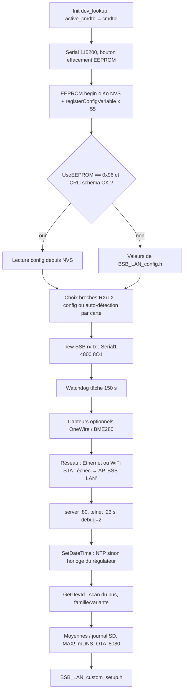
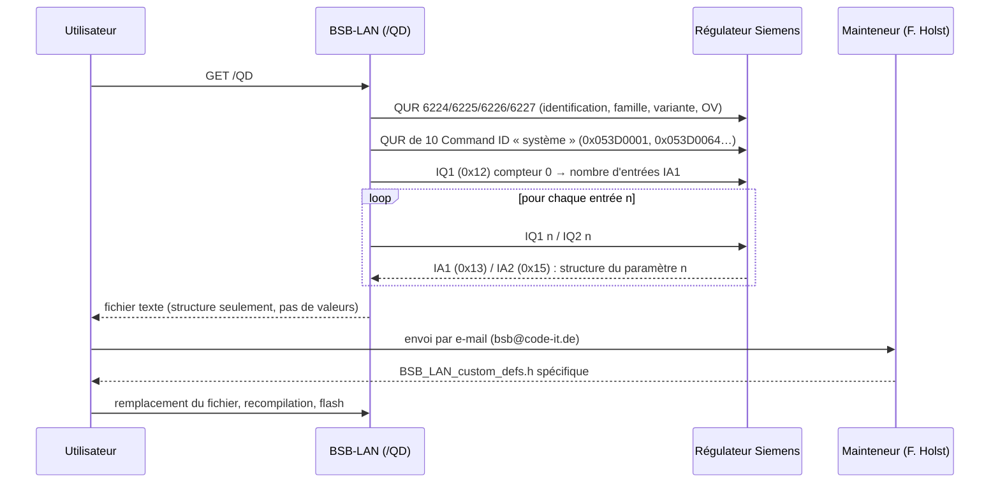

# 01 — Architecture de BSB-LAN

> **Résumé**
> BSB-LAN 5.1.34 est un *sketch Arduino monolithique* (`BSB_LAN.ino`, 8 449 lignes) qui inclut des en-têtes contenant du code (pas des unités de compilation séparées). Plateformes : ESP32 (Xtensa et RISC-V C3/C6) et Arduino Due ; la sélection se fait par les macros du *board package* (`ESP32`, `__SAM3X8E__`, `ARDUINO_ESP32C3_DEVKIT_LIPO`…), pas par un `#define` utilisateur.
> Presque toutes les fonctionnalités sont activées **à l'exécution** (variables de `BSB_LAN_config.h`, surchargées par la NVS/EEPROM), donc **compilées en permanence** : la réduction de taille passera par l'ajout de gardes `#if`.
> La table des paramètres (`cmdtbl`) n'est plus universelle : la version livrée ne contient que ~18 paramètres génériques ; la liste complète est **spécifique au régulateur** et produite hors ligne par le mainteneur à partir d'un dump `/QD`.
> Points chauds : boucle `loop()` coopérative et bloquante (serveur HTTP, bus, MQTT dans le même fil), tampons de 2 Ko sur la pile pour MQTT, table `heating_cmdtbl` de 16 Ko en RAM statique.

Conventions : **[CONSTATÉ]** = lu dans le code/la doc du dépôt (référence `fichier:ligne`) ; **[SUPPOSÉ]** = déduction non vérifiée ; **[À VÉRIFIER]** = question ouverte. Les chemins sont relatifs à la racine du dépôt.

---

## 1. Structure du dépôt

### 1.1 Arborescence commentée

```
.
├── BSB_LAN/                       ← le sketch Arduino (dossier = nom du .ino, imposé par l'IDE)
│   ├── BSB_LAN.ino                ← TOUT le programme principal : setup(), loop(), serveur HTTP, décodage, config
│   ├── BSB_LAN_config.h.default   ← configuration utilisateur (à copier en BSB_LAN_config.h, ignoré par git)
│   ├── BSB_LAN_custom_defs.h.default ← table des paramètres cmdtbl[] + chaînes + ENUM (à copier en BSB_LAN_custom_defs.h)
│   ├── BSB_LAN_defs.h             ← types (cmd_t, units), types VT_*, optbl[], drapeaux FL_*, familles DEV_*, paramètres PPS/virtuels
│   ├── BSB_LAN_EEPROMconfig.h     ← schéma de la configuration persistante (enum CF_*, table config[])
│   ├── BSB_LAN_custom*.h          ← 4 points d'injection de code utilisateur (global, setup, loop, réception de trame)
│   ├── include/                   ← « modules » inclus textuellement dans BSB_LAN.ino
│   │   ├── mqtt_handler.h         ← MQTT : publication, auto-discovery HA, abonnement/commandes
│   │   ├── print_telegram.h       ← décodage d'une trame → valeur texte (switch sur VT_*)
│   │   ├── broadcast_msg_handling.h ← trames INF diffusées (heure, statut brûleur/ECS → compteurs 20000-20005)
│   │   ├── pps_handling.h         ← protocole PPS (non utilisé en BSB)
│   │   ├── print_webpage.h, print2webclient.h, print2debug.h ← génération HTML, tampons de sortie
│   │   ├── print_ipwe.h           ← émulation IPWE (/ipwe.cgi)
│   │   └── eeprom_io.h            ← lecture/écriture de la config dans l'EEPROM émulée (NVS)
│   ├── src/                       ← bibliothèques vendues avec le projet (compilées par l'IDE)
│   │   ├── BSB/                   ← classe BSB : couche liaison du bus (bsb.cpp/.h)
│   │   ├── PubSubClient/          ← client MQTT
│   │   ├── OneWireNg, DallasTemperature, DHTesp, BlueDot_BME280 ← capteurs optionnels
│   │   ├── ArduinoMDNS, SdFat, Time, I2C_EEPROM ← spécifiques Arduino Due (non compilés/liés sur ESP32, cf. #if)
│   │   ├── modbus-esp8266         ← utilisé seulement par custom_functions/Modbus_Interface
│   │   └── Base64, CRC32, esp32_time.h
│   ├── localization/              ← LANG_xx.h (chaînes), UNDEF_LANG_xx.h, scripts Perl de génération
│   ├── json/                      ← traductions pour l'interface JSON (non compilées dans le firmware)
│   ├── html_strings.h             ← CSS/JS/HTML embarqués (favicon, page /DG de tracé…)
│   ├── x509_cert_bundle.h         ← bundle de certificats racine pour MQTT/TLS (56 244 octets)
│   ├── partitions.csv, partitions/default_16MB.csv ← tables de partitions ESP32
│   ├── custom_functions/          ← exemples d'extensions (non compilés par défaut)
│   ├── scripts/, data/, 3D printer files/, schematics/bsb_adapter.pdf
├── docs/                          ← manuel mkdocs (en, de, fr) + images
├── openapi.yaml                   ← description de l'API JSON
└── .github/workflows/             ← CI : arduino-cli (Due), recovery ESP32, localisation, version
```

Fichiers sources compilés : `BSB_LAN.ino` + tous les `.cpp` de `src/**` (règle de l'IDE Arduino). Les fichiers `include/*.h` sont inclus *au milieu* de `BSB_LAN.ino` (ex. `BSB_LAN/BSB_LAN.ino:1779-1780`, `:1838`, `:4270`) : ils partagent l'espace de noms global et ne sont **pas** des modules indépendants **[CONSTATÉ]**.

### 1.2 Système de build

| Élément | Constat |
|---|---|
| Outil officiel | Arduino IDE / `arduino-cli`. **Aucun `platformio.ini` dans le dépôt** [CONSTATÉ]. |
| CI amont | `.github/workflows/esp32-recovery.yaml` compile avec `arduino-cli` pour `esp32:esp32:esp32`, `esp32-evb`, `esp32-poe-iso` avec `PartitionScheme=min_spiffs` (lignes 148-151 du fichier) ; `.github/workflows/arduino-cli.yaml` pour le Due. Aucune cible C3 en CI [CONSTATÉ]. |
| Version du core requise | Code écrit pour **arduino-esp32 3.x** (ESP-IDF 5) : `NetworkClientSecure.h` / `NetworkServer` (`BSB_LAN/BSB_LAN.ino:233`, `:322-324`), `esp_task_wdt_config_t` (`:7985-7990`). Ne compile pas avec le core 2.x [CONSTATÉ par lecture ; SUPPOSÉ pour l'échec en 2.x]. |
| Partition | `#error` si le schéma n'est pas `min_spiffs` et que `CUSTOM_PARTITION_TABLE` n'est pas défini (`BSB_LAN/BSB_LAN.ino:179-181`). `partitions.csv` : 2 × 0x1E0000 (1 966 080 o) en OTA + SPIFFS 128 Ko + coredump 64 Ko. |
| Config | `BSB_LAN_config.h` doit exister (`#error` `BSB_LAN/BSB_LAN.ino:26-30`) et avoir `CONFIG_VERSION >= 43` (`:183-186`). |

Conséquence pour la mission : un environnement **PlatformIO** devra utiliser la plateforme communautaire *pioarduino* (le paquet `espressif32` officiel de PlatformIO reste sur arduino-esp32 2.0.x) **[SUPPOSÉ, à confirmer en Phase 3]**, ou bien on garde `arduino-cli` dans Docker comme la CI amont. Voir 07_faisabilite §6.2.

### 1.3 Plateformes et mécanisme de sélection

Il n'y a **pas** de `#define BOARD_xxx` utilisateur : la plateforme est déduite des macros fournies par le core :

| Macro | Effet | Référence |
|---|---|---|
| `ARDUINO_ARCH_ESP32` → `ESP32` | Active toute la branche ESP32 (WiFi, NVS, OTA, LittleFS, WebServer:8080) | `BSB_LAN/BSB_LAN.ino:18-20`, `:232-249` |
| `__AVR__` | `#error` (Mega abandonné) | `:22-24` |
| `__arm__` / `__SAM3X8E__` | Arduino Due : EEPROM I²C 24LC32, Ethernet W5100, SdFat, pas de TLS | `:220-230`, `:370-376` |
| `ARDUINO_ESP32C3_DEVKIT_LIPO` | **Olimex ESP32-C3** : bouton d'effacement GPIO9, LED GPIO8, bus RX=20 / TX=10 ou 21 | `:195-197`, `:212-214`, `:7930-7937` |
| `ARDUINO_ESP32C6_EVB` | Olimex ESP32-C6 | `:7938-7945` |
| `ARDUINO_ESP32_EVB`, `_POE`, `_POE_ISO` | Olimex ESP32 classiques (RX=36) | `:7914-7929` |
| (défaut ESP32) | NodeMCU ESP32 : RX=16, TX=17, bouton d'effacement GPIO21 | `:198-200`, `:7949-7951` |
| `SOC_SDMMC_HOST_SUPPORTED` | SD_MMC si le SoC l'a, sinon SD en SPI (cas du C3) | `:430-437` |

**Fait important** : un ESP32-C3 est **déjà supporté en amont** (Olimex ESP32-C3-DevKit-Lipo) ; le code compile donc pour une cible RISC-V monocœur. Les broches RX/TX sont configurables à l'exécution (`bus_pins[]`, `BSB_LAN/BSB_LAN_config.h.default:125`) — une carte C3 générique fonctionne avec un réglage manuel.

---

## 2. Cycle de vie du firmware

### 2.1 `setup()` — `BSB_LAN/BSB_LAN.ino:7707-8449`



Points notables [CONSTATÉ] :
- La configuration est un tableau d'options `CF_*` enregistrées par pointeur (`registerConfigVariable`, `BSB_LAN/BSB_LAN.ino:7767-7830`) puis lues/écrites dans l'« EEPROM » émulée sur la partition `nvs` (`EEPROMClass EEPROM_ESP("nvs")`, `:244`).
- `GetDevId()` (`:4107-4231`) envoie un `QINF` 0x053D0064 en diffusion (dest. 0x7F) et écoute 10 s les réponses `INF` pour remplir `dev_lookup[10]` (famille, variante, OC, n° de série, nom 17 car.).
- En l'absence de réseau WiFi, un point d'accès `BSB-LAN` / mot de passe **codé en dur** `BSB-LPB-PPS-LAN` est créé (`:7665-7677`), avec reboot au bout de 30 min (`:7418-7421`).

### 2.2 `loop()` — `BSB_LAN/BSB_LAN.ino:4579-7464`

Boucle unique, coopérative, sans tâche FreeRTOS dédiée. Ordre d'exécution à chaque tour :

| # | Étape | Lignes | Bloquant ? |
|---|---|---|---|
| 1 | `Ethernet.maintain()` (LAN seulement) | 4588-4621 | non |
| 2 | `bus->GetMessage()` → `printTelegram`, `broadcast_msg_handling`, PPS, hook `BSB_LAN_custom_GetMessage.h` | 4625-4664 | jusqu'à ~73 ms (trame 32 o) |
| 3 | `server->accept()` puis **traitement complet de la requête HTTP** (parse en-têtes, auth, routage `p[1]`) | 4667-6994 | **oui** : une requête `/K` ou `/QD` peut durer des secondes à minutes |
| 4 | MQTT : `mqtt_connect()`, `loop()`, publication périodique de `log_parameters[]` toutes les `log_interval` s | 6996-7050 | ~100 ms par paramètre interrogé |
| 5 | Journalisation SD/UDP, moyennes 24 h | 7052-7230 | variable |
| 6 | OneWire / DHT / BME (si activés), hook `BSB_LAN_custom.h` | 7240-7270 | |
| 7 | MAX! (CUL), telnet, serveur OTA `update_server.handleClient()` | 7273-7415 | |
| 8 | Maintenance 60 s : re-détection appareil, NTP, reconnexion WiFi | 7423-7456 | scan WiFi ≈ 2-3 s |
| 9 | `esp_task_wdt_reset()` | 7461-7463 | |

Conséquences [CONSTATÉ + calcul] :
- Une requête de paramètre coûte : attente bus libre 63-82 ms (`src/BSB/bsb.cpp:362`) + émission 11 o × 2,29 ms = 25 ms + réponse ≈ 14 o × 2,29 ms = 32 ms, soit **≈ 120-140 ms/paramètre**, ×3 tentatives max en cas d'échec (`QUERY_RETRIES`, `BSB_LAN/BSB_LAN.ino:116`). Publier 20 paramètres MQTT bloque donc la boucle ≈ 2,5-3 s : sans conséquence pour le BSB (maître = régulateur) mais à prendre en compte pour la réactivité HTTP.
- Pendant ce temps les trames diffusées par le régulateur s'accumulent dans le FIFO UART (128 o matériel + tampon logiciel 256 o par défaut dans arduino-esp32 [SUPPOSÉ : valeur par défaut du core]).

### 2.3 Réseau

- WiFi : `WiFi.mode(WIFI_STA)`, bande passante forcée HT20, *modem sleep* désactivé (`BSB_LAN/BSB_LAN.ino:8166-8176`), scan et connexion au BSSID le plus fort (`:7468-7519`), reconnexion toutes les 60 s (`:7435-7454`).
- Ethernet (ESP32 : PHY LAN8720 RMII, `:279-321`) — **inexistant sur C3** (pas de MAC Ethernet). Le code reste compilé car `ETH.h` existe pour les PHY SPI ; à neutraliser pour gagner de la flash [SUPPOSÉ : gain à mesurer].
- Services : HTTP :80 (serveur « maison » sur `NetworkServer`), OTA HTTP :8080 (`WebServer` + `Update`), telnet :23 (si `debug_mode==2`), mDNS, UDP de log :6502, client MQTT, client TLS optionnel.

### 2.4 Mémoire : points chauds identifiés

| Objet | Taille | Référence | Remarque |
|---|---|---|---|
| `heating_cmdtbl[MAX_HEATINGTBL]` | 500 × `sizeof(cmd_t)` = 500 × 32 = **16 000 o** (.bss) | `BSB_LAN/BSB_LAN_defs.h:618`, `BSB_LAN/BSB_LAN.ino:172` | utilisée seulement par `/QDB`. `sizeof(cmd_t)`=32 calculé (4+1+3 pad+4+4+2+2 pad+4+4+1+1+2 pad) [SUPPOSÉ, à confirmer sur le .map]. |
| `MQTTPayload[2048]` + `MQTTTopic[80]` | 2 128 o **sur la pile** | `include/mqtt_handler.h:51-52`, `:180-181` | appelé depuis `loop()` (pile 8 Ko par défaut dans arduino-esp32) ; `mqtt_callback` → `query()` → `LogToMQTT()` → `mqtt_sendtoBroker()` empile en plus ~2 Ko. |
| Tampon PubSubClient | 2 048 o (tas) | `include/mqtt_handler.h:399` | |
| `bigBuff`, `outBuf`, `DebugBuff` | 1 350 + 450 + 450 o | `BSB_LAN/BSB_LAN.ino:357-368` | |
| `x509_cert_bundle` | 56 244 o (flash) | `BSB_LAN/x509_cert_bundle.h` | supprimé si `NO_TLS` |
| Chaînes de langue | toutes en flash (`const char[]`) | `localization/` | une seule langue compilée (`LANG`) + repli EN + DE |

---

## 3. Table des commandes (`cmdtbl`)

### 3.1 Structure d'une entrée — `BSB_LAN/BSB_LAN_defs.h:604-616`

```c
typedef struct {
  uint32_t    cmd;          // Command ID 32 bits (ex. 0x053D0521) ; CMD_UNKNOWN=0 pour les virtuels
  uint8_t     type;         // type de valeur VT_* → index dans optbl[]
  float       line;         // numéro de paramètre (ProgNr), ex. 8700 ; décimales pour sous-éléments (20100.1)
  const char *desc;         // libellé (chaîne localisée STRxxxx)
  uint16_t    enumstr_len;  // taille de la chaîne d'énumération
  const char *enumstr;      // ENUMxxxx : suite de "\xVV libellé\0"
  uint32_t    flags;        // FL_RONLY, FL_WONLY, FL_OEM, FL_SW_CTL_RONLY, FL_SPECIAL_INF…
  uint8_t     dev_fam;      // famille d'appareil (255 = toutes)
  uint8_t     dev_var;      // variante (255 = toutes)
} cmd_t;
```

Exemple réel (`BSB_LAN/BSB_LAN_custom_defs.h.default:7159`) :
```c
{0x053D0521, VT_TEMP, 8700, STR8700, 0, NULL, DEFAULT_FLAG, DEV_ALL}, // Température extérieure
```

### 3.2 Types de données et conversion — `optbl[]` (`BSB_LAN/BSB_LAN_defs.h:593-602`, `:644-…`, `:822-…`)

Chaque `VT_*` est un index dans `optbl[]` qui donne :

| Champ `units` | Rôle | Exemple `VT_TEMP` (`BSB_LAN_defs.h:928`) |
|---|---|---|
| `operand` | diviseur (valeur = brut / operand) | 64.0 |
| `enable_byte` | 1er octet de charge utile : 0x00 = valide, 0x01/0x06 = « désactivé / --- » | 1 |
| `payload_length` | octets de valeur (+32 traitement spécial, +64 longueur variable) | 2+32 |
| `data_type` | DT_VALS, DT_ENUM, DT_BITS, DT_HHMM, DT_DTTM… (`:304-316`) | DT_VALS |
| `precision` | décimales affichées | 1 |
| `unit` | énum `UNIT_*` → texte localisé / texte HA (`U_HOMEASSISTANT`) | UNIT_DEG |

Exemple : réponse de 8700 avec charge utile `00 01 40` → enable 0x00, brut = 0x0140 = 320 (int16 signé) → 320/64 = **5,0 °C**. Le décodage est fait par le grand `switch` de `include/print_telegram.h` (cas `VT_TEMP` en `:1060`).

Les ENUM sont des chaînes concaténées `"\xVV libellé\0"` (ex. `ENUM15046`, `BSB_LAN/BSB_LAN_defs.h:1298-1310`) ; c'est ce format qui est parcouru pour générer les `options` des entités `select` HA (`include/mqtt_handler.h:300-310`).

### 3.3 Recherche d'un paramètre et sélection par appareil

`findLine(line)` (`BSB_LAN/BSB_LAN.ino:1089-1238`) :
1. Paramètres virtuels ≥ 20000 traités à part (`:1099-1155`).
2. **Recherche linéaire** O(N) sur `active_cmdtbl` (le commentaire « binary search » est trompeur ; l'ancienne dichotomie est commentée, `:1157-1196`).
3. Parmi les entrées de même `line`, choix de la meilleure correspondance `(dev_fam, dev_var)` = (`my_dev_fam`, `my_dev_var`) obtenus par `GetDevId()`, avec repli sur `DEV_ALL` (255,255) (`:1200-1233`).

C'est ainsi qu'une même table peut contenir plusieurs variantes d'un paramètre pour plusieurs régulateurs.

### 3.4 Génération d'une liste spécifique à l'appareil (point crucial)

Constat [CONSTATÉ, `docs/en/install.md:49-57`, `docs/en/CHANGELOG.md:150`, `BSB_LAN/BSB_LAN.ino:5250-5629`] :



- Le dump interroge la **table interne du régulateur** via les types de télégrammes non documentés `IQ1/IA1/IQ2/IA2` (0x12-0x15, `BSB_LAN/BSB_LAN_defs.h:42-45`).
- Le passage dump → `BSB_LAN_custom_defs.h` **n'est pas automatisé** et se fait chez le mainteneur (`docs/en/install.md:52`). C'est une **dépendance humaine externe** pour la mission (cf. questions ouvertes).
- Variante embarquée `/QDB` : construit en RAM (`heating_cmdtbl`, 500 entrées max) une table **lecture seule**, typée uniquement `VT_TEMP` ou `VT_PERCENT`, sans libellés (« Parameter »), active jusqu'au redémarrage (`BSB_LAN/BSB_LAN.ino:5489-5503`, `:5613-5621`). Utile pour un diagnostic, pas pour HA.
- Le fichier livré par défaut contient seulement **18 entrées** (`grep -c '^{0x'` sur `BSB_LAN_custom_defs.h.default`) : date/heure, 710 (consigne confort CC1), 6224-6227 (identification), 6604/6606, 8700 (T ext.), 10000-10002 (température ambiante en INF)…, plus 55 entrées fixes dans `BSB_LAN_defs.h` (PPS 15000-15086, virtuels 20000-20899, pseudo-entrées 65522-65535).

**Implication pour la réduction** : la taille de la table dépend uniquement du `BSB_LAN_custom_defs.h` installé. Le fichier `.default` pèse 244 Ko de source mais compile en peu d'octets, car la quasi-totalité des `STRxxxx`/`ENUMxxxx` qu'il déclare sont des `const` non référencés, éliminés par l'éditeur de liens [SUPPOSÉ : à confirmer avec le `.map` du build de mesure]. Une liste Alféa complète (≈ 400-800 paramètres pour un RVS21 [SUPPOSÉ, ordre de grandeur]) pourra en revanche coûter plusieurs dizaines de Ko ; il faudra la **filtrer** aux paramètres utiles.

---

## 4. Configuration

### 4.1 Deux niveaux

| Niveau | Mécanisme | Exemples |
|---|---|---|
| Compilation | `#define` dans `BSB_LAN_config.h` ou macros internes surchargeables par `#undef/#define` | `LANG`, `DEFAULT_FLAG`, `CONFIG_VERSION`, `NO_TLS`, `CUSTOM_PARTITION_TABLE`, `USE_ADVANCED_PLOT_LOG_FILE`, `D3_LIBRARY_PATH`, `SD_*`, `LED_BUILTIN`, `EEPROM_ERASING_PIN`, `WDT_TIMEOUT`, `MAX_HEATINGTBL`, `UDP_LOG_PORT`, `QUERY_RETRIES`, `BtSerial`, `WATCH_SOCKETS`, `I_WANT_INSECURE_TLS_AND_I_KNOW_WHAT_I_AM_DOING` |
| Exécution | variables globales initialisées par `BSB_LAN_config.h`, puis écrasées par la NVS si `UseEEPROM` = 0x96 et CRC du schéma OK (`BSB_LAN/BSB_LAN.ino:7832-7883`) ; modifiables via `/C` (page web) ou `/JW` (JSON) | réseau, WiFi, MQTT, bus, broches, journalisation, mode écriture… |

Schéma persistant : `BSB_LAN/BSB_LAN_EEPROMconfig.h` (enum `CF_*`, versions 0 à 14+), stocké dans 4 Ko (`EEPROM_SIZE 0x1000`, `BSB_LAN/BSB_LAN.ino:189`). Effacement par bouton (GPIO 21 sur NodeMCU, 9 sur Olimex C3) maintenu au boot (`:7756-7762`) ou `/NE`.

### 4.2 Liste exhaustive des fonctionnalités activables

| Fonction | Variable / macro | Défaut | Référence config |
|---|---|---|---|
| Langue | `LANG` | EN | `BSB_LAN_config.h.default:16` |
| Réseau LAN/WLAN, DHCP, IP fixe | `network_type`, `useDHCP`, `ip_addr`… | LAN, DHCP | `:30-36` |
| WiFi SSID/clé/BSSID | `wifi_ssid`, `wifi_pass`, `bssid` | exemples | `:38-40` |
| mDNS | `mDNS_hostname` | "BSB-LAN" | `:42` |
| NTP + fuseau | `ntp_server`, `local_timezone` | pool.ntp.org, CET | `:55-56` |
| Passkey URL | `PASSKEY` | vide | `:75` |
| IP de confiance (×2) | `trusted_ip_addr*` | off | `:81-82` |
| HTTP Basic Auth | `USER_PASS` | vide | `:89` |
| Bus BSB/LPB/PPS, adresses | `bus_type`, `own_address` (0x42), `dest_address` (0x00) | BSB | `:99-108` |
| PPS : écriture, type QAA | `pps_write`, `QAA_TYPE` | 0, QAA70 | `:111-112` |
| Broches RX/TX | `bus_pins[2]` | auto (0,0) | `:125` |
| **Lecture seule** | `DEFAULT_FLAG` (+ `programWriteMode` runtime) | `FL_SW_CTL_RONLY` (+ mode 0 = lecture seule) | `:132` |
| Destination de log SD/flash | `LogDestination` | SDCARD | `:136-141` |
| Journal brut des trames | `logTelegram` | off | `:155` |
| Journal des valeurs (SD, MQTT, UDP) | `LoggingMode`, `log_interval`, `log_parameters[40]` | 0 / 300 s | `:161-177`, `:205` |
| **MQTT** | `mqtt_broker_addr`, `MQTTUsername/Password`, `MQTTTopicPrefix`, `mqtt_mode` (1 texte, 2 JSON, 3 JSON riche), `mqtt_unit_set`, `MQTTDeviceID`, `MQTTRefAD` | désactivé (`LoggingMode`=0) | `:179-202` |
| Moyennes 24 h | `avg_parameters[40]` | 8700, 8326 | `:208-212` |
| Valeur « désactivé » | `replaceDisabled` | "---" | `:215` |
| OneWire DS18B20 | `One_Wire_Pin` | -1 | `:218` |
| DHT22 (×10) | `DHT_Pins` | -1 | `:221` |
| BME280 (×16 avec TCA9548A) | `BME_Sensors` | 0 | `:225` |
| IPWE | `enable_ipwe`, `ipwe_parameters` | off | `:227-242` |
| Tracé /DG avancé (JS distant) | `USE_ADVANCED_PLOT_LOG_FILE` | on | `:253-265` |
| MAX! (CUNO/CUL) | `enable_max_cul`… | off | `:267-272` |
| Vérification de version (Internet) | `enable_version_check` | off | `:283` |
| OTA HTTP :8080 | `enable_ota_update` | off | `:289` |
| Économie d'énergie (80 MHz) | `esp32_save_energy` | off | `:293` |
| Serveur de fichiers statiques | `webserver` | off | `:296` |
| Debug série/telnet, verbosité | `debug_mode`, `verbose`, `show_unknown` | 1, 1, true | `:299-301` |
| TLS (MQTT sécurisé) | `NO_TLS` | TLS compilé | `:305` |
| Extensions utilisateur | `BSB_LAN_custom*.h` + `custom_functions/` | exemple « Ping » | `BSB_LAN/BSB_LAN_custom.h` |

**Constat clé** : à l'exception de `NO_TLS`, aucune de ces fonctionnalités n'est retirable à la compilation : leur code (OneWire, DHT, BME280, MAX!, IPWE, SD/LittleFS, journalisation, telnet, tracé, Ethernet) est toujours lié. Voir `05_fonctionnalites.md` pour le chiffrage.

---

## 5. Constats de sécurité utiles pour la suite

| # | Constat | Référence | Impact Alféa |
|---|---|---|---|
| S1 | Le « mode lecture seule » est **logiciel** : `programIsreadOnly()` refuse `set()` si `programWriteMode == 0`, mais ce mode est modifiable à distance par la page `/C` ou `/JW` | `BSB_LAN/BSB_LAN.ino:1376-1388`, `:2919-2922`, `:7820-7822` | Pour une vraie lecture seule par défaut : `DEFAULT_FLAG = FL_RONLY` à la compilation |
| S2 | **Trois routes émettent un télégramme brut arbitraire** (type quelconque, y compris SET 0x03) **sans passer par `programIsreadOnly()`** : `/YR<hex>` (relais, si `debug_mode != 0`, =1 par défaut), `/Y<type><cmd>…` (si `debug_mode != 0`) et **`/JY<type>,<cmd>,<payload>` sans aucune condition** | `BSB_LAN/BSB_LAN.ino:5630-5646`, `:5676-5710`, `:5804-5832` | **Contournement de la lecture seule** → les trois routes sont à exclure à la compilation |
| S3 | `/G<pin>=<v>` pilote n'importe quelle GPIO (y compris TX du bus ou broches de strapping) | `BSB_LAN/BSB_LAN.ino:6840-6884` | à supprimer |
| S4 | AP de secours avec mot de passe public codé en dur | `BSB_LAN/BSB_LAN.ino:7669` | à remplacer ou désactiver |
| S5 | Authentification : Basic Auth en clair, passkey dans l'URL ; OTA sans auth si `USER_PASS` vide | `:4757-4779`, `:1841-1889` | réseau local de confiance + mot de passe obligatoire |
| S6 | Le canal MQTT `…/set` et le payload hérité `S<n>=<v>` appellent `set()` (donc protégés par S1) | `include/mqtt_handler.h:583-584`, `:641-669` | OK si S1 durci |
