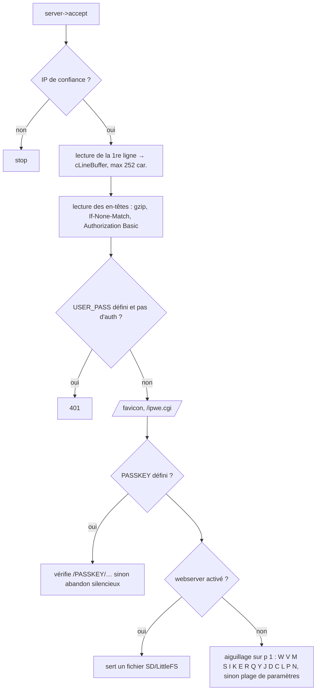

# 03 — Serveur web et API

> **Résumé**
> - Le serveur HTTP (port 80) est écrit à la main sur `NetworkServer`. Il est **mono-client et bloquant**, codé dans `loop()` (`BSB_LAN/BSB_LAN.ino:4667-6994`), et l'aiguillage se fait sur la première lettre de l'URL (`p[1]`).
> - Une API JSON (`/J*`, spécifiée dans `openapi.yaml`) double les commandes HTML.
> - Un second serveur, `WebServer` sur le port 8080, ne sert qu'à l'OTA.
> - Sécurité possible : passkey dans l'URL, Basic Auth, liste d'IP autorisées. Aucun TLS côté serveur.
> - Pour l'Alféa avec Home Assistant en MQTT, il suffit de garder : la page d'accueil minimale, la lecture `/<n>`, `/K`, `/JQ`, `/JI`, `/C` + `/JL`/`/JW`, `/N`, `/Q`/`/QD` et `/M`, plus l'OTA.
> - À supprimer : `/Y`, `/YR`, `/JY` (émission brute sans contrôle de la lecture seule), `/G` (pilotage de GPIO), IPWE, journaux SD, `/DG`, MAX!, et le serveur de fichiers.

Conventions : **[CONSTATÉ]**, **[SUPPOSÉ]**, **[À VÉRIFIER]**.

---

## 1. Fonctionnement du serveur

- [CONSTATÉ] Le parsing et l'authentification sont dans `BSB_LAN/BSB_LAN.ino:4684-4833`. Le client est fermé à la fin (`:6983-6993`) ou si plus de 1 000 tours sans données (`:6969-6974`).
- [CONSTATÉ] La sortie passe par un tampon `bigBuff` de 1 350 o, vidé automatiquement (`include/print2webclient.h`). Les pages sont produites à la volée (`printToWebClient`), sans gabarit en RAM.
- [CONSTATÉ] Une même ligne de commande peut aussi arriver par le port série (`SerialOutput->available()`, `:4668`, `:4695-4708`) : on peut piloter BSB-LAN depuis le terminal USB.
- Conséquence : tant qu'une requête est servie, le bus n'est pas lu. Les trames diffusées attendent dans le FIFO et les publications MQTT sont retardées. Une requête `/K` sur une catégorie de 50 paramètres dure environ 50 × 130 ms ≈ 6,5 s [calcul, cf. 01 §2.2].

## 2. Routes (URL commands)

Sources : `docs/en/using.md:20-120` [CONSTATÉ] et aiguillage `BSB_LAN/BSB_LAN.ino` (numéros de ligne ci-dessous).

| Route | Fonction | Ligne | Écrit sur le bus ? | Verdict Alféa |
|---|---|---|---|---|
| `/` | page d'accueil (menu) | 4971-4974, `include/print_webpage.h:121` | non | **indispensable** (simplifiée) |
| `/<x>`, `/<x>-<y>`, `/<x>!<addr>` | lecture de paramètres | 6891-6962 | non (QUR) | **indispensable** |
| `/K`, `/K<n>` | catégories, lecture d'une catégorie | 5120, 6901-6918 | non | **indispensable** |
| `/S<x>=<v>`, `/I<x>=<v>` | écriture SET / INF | 5047-5118 | **oui**, via `set()` → contrôle lecture seule | conservé, **bloqué par défaut** (cf. 08) |
| `/E<x>` | options d'un ENUM | 5166 | non | optionnel |
| `/R<x>` | valeur par défaut (QRV) | 5191 | non | optionnel |
| `/Q` | dump de structure | 5232 | non (QUR/IQ) | **utile** une fois (identification) |
| `/QD`, `/QDF`, `/QDB` | dump pour liste spécifique ; table temporaire | 5250-5629 | non (IQ1/IQ2) | `/QD` **indispensable** au départ ; `/QDB` supprimable (libère 16 Ko de RAM) |
| `/Y…`, `/YR…` | télégramme brut ; relais entre instances | 5630-5744 | **oui, sans contrôle** | **à supprimer** |
| `/J…` | API JSON (§3) | 5745-6378 | `/JS` via `set()` ; **`/JY` sans contrôle** | voir §3 |
| `/D…`, `/DG` | journaux SD/flash, tracé graphique | 6379-6562 | non | supprimable |
| `/C`, `/CO` | page de configuration, dump de la config | 6564-6620, `generateWebConfigPage` 2416 | non | **utile** (réglages WiFi/MQTT) |
| `/L…`, `/A…`, `/B0`, `/LB`, `/LU` | journalisation, moyennes 24 h, compteurs brûleur | 6622-6717, 6803-6890 | non | supprimable (garder `/B0` si on garde 20000+) |
| `/P<bus>,<own>,<dst>` | change temporairement bus et adresses | 6719-6772 | non | supprimable (risque de mauvaise manipulation) |
| `/N`, `/NE` | redémarrage ; effacement de la NVS | 6774-6798 | non | **utile** |
| `/G<pin>…` | lecture/écriture de **GPIO quelconque** | 6840-6884 | non, mais peut forcer la TX du bus | **à supprimer** |
| `/M<0/1>!<addr>` | (dé)publication de l'auto-discovery MQTT | 4997-5045 | non | **indispensable** |
| `/V<n>`, `/W…` | verbosité ; fragments HTML sans en-tête | 4977-4995 | non | optionnel |
| `/ipwe.cgi` | émulation IPWE | 4794-4797, `include/print_ipwe.h` | non | supprimable |
| `/favicon.ico/.svg` | icônes | 4800-4814 | non | garder (quelques centaines d'octets) |
| `:8080/` et `/update` | OTA (`WebServer` + `Update`) | 1841-1889 | non | **utile**, avec mot de passe obligatoire |

## 3. API JSON

[CONSTATÉ] `docs/en/using.md:88-108`, `openapi.yaml`, `BSB_LAN/BSB_LAN.ino:5745-6378`.

| Route | Rôle | Verdict |
|---|---|---|
| `/JQ=<x>,<y>` ou POST | lecture → `{"8700":{"name","value","unit","desc","dataType","readwrite",…}}` | **garder** (secours REST pour HA, debug) |
| `/JS` (POST) | écriture via `set()` | garder, bloqué par la lecture seule |
| `/JR`, `/JC`, `/JK` | défaut, structure, catégories | garder `/JK`, `/JC` (outils) ; `/JR` optionnel |
| `/JB` | sauvegarde de tous les paramètres modifiables | optionnel (utile **avant** toute future écriture) |
| `/JL`, `/JW` | lecture / écriture de la configuration BSB-LAN | garder |
| `/JI`, `/JV` | informations d'exécution, version de l'API | garder (supervision : RSSI, heap…) |
| **`/JY<type>,<cmd>[,payload][!addr]`** | **émission brute d'un type quelconque, y compris SET, sans `programIsreadOnly()` ni condition `debug_mode`** (`:5804-5832`) | **à supprimer** |

L'intégration HA « officielle » côté HA (intégration *BSB-LAN* de Home Assistant core) consomme cette API JSON en HTTP (cf. 04).

## 4. Authentification et sécurité

| Mécanisme | Implémentation | Limite |
|---|---|---|
| IP de confiance (×2) | comparaison de `remoteIP` (`:4673-4681`) | **[CONSTATÉ, bug probable]** le test est un `&&` : le rejet n'a lieu que si les deux IP sont configurées *et* différentes de l'IP du client. Avec une seule IP configurée (`trusted_ip_addr2[0] == 0`), le second terme est faux et **personne n'est rejeté**. **[À VÉRIFIER]** par un test, puis à signaler en amont |
| Passkey | premier segment de l'URL (`:4818-4833`) | circule en clair, se retrouve dans les journaux et l'historique |
| Basic Auth | comparaison base64 de `USER_PASS` (`:4757-4779`) | en clair sans TLS ; relit `USER_PASS` et ré-encode à chaque ligne d'en-tête |
| OTA | Basic Auth seulement si `USER_PASS` est défini (`:1843-1850`) | **sans mot de passe, n'importe qui sur le LAN peut flasher** |

Recommandations pour la cible : `USER_PASS` obligatoire (refus de démarrer l'OTA sinon) ; pas de passkey ; réseau domestique ou VLAN IoT ; MQTT avec identifiants.

## 5. Bilan : indispensable / optionnel / supprimable

| Catégorie | Contenu |
|---|---|
| **Indispensable** | accueil minimal, lecture `/<n>`, `/K`, `/JQ`, `/JI`, `/C`+`/JL`+`/JW` (ou portail de config), `/N`, `/M`, `/QD` (phase d'identification), OTA protégé |
| **Optionnel** | `/E`, `/R`, `/JR`, `/JC`, `/JK`, `/JB`, `/V`, `/W`, `/JS` (inerte tant que la lecture seule est active) |
| **Supprimable** (gain flash et réduction de la surface d'attaque) | `/Y`, `/YR`, `/JY`, `/G`, `/P`, `/QDB` (+ `heating_cmdtbl`), `/D*` et `/DG` (+ `graph_html`), `/L*`, `/A*`, `/ipwe.cgi`, serveur de fichiers, telnet, tous les menus MAX!/OneWire/DHT/BME de la page `/C` |

Les gains en octets sont chiffrés dans `05_fonctionnalites.md` et `07_faisabilite_esp32c3.md` §6.4.
