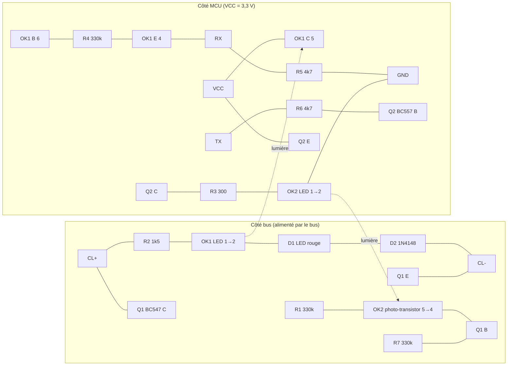

# 06 — La carte d'interface BSB (adaptateur)

> **Résumé**
> Le dépôt contient **un seul schéma** (`BSB_LAN/schematics/bsb_adapter.pdf`). C'est l'adaptateur pour Arduino Due de génération V3 : deux optocoupleurs 4N25, un transistor de tirage BC547 côté bus, un PNP BC557 côté MCU et une EEPROM 24LC32. Les schémas des adaptateurs ESP32 (« v4.x ») **ne sont pas dans le dépôt**. La doc dit seulement qu'ils sont électriquement identiques à part les connecteurs.
> Réception : la LED de l'optocoupleur est en série avec 1,5 kΩ et une LED témoin ; il faut ≈ 3,7 V pour qu'elle conduise et elle tire ≈ 6 mA à 13 V. Côté MCU, un émetteur-suiveur sur 4,7 kΩ donne un signal **non inversé**. Émission : TX bas → PNP → LED de l'optocoupleur (≈ 6 mA sous 3,3 V) → BC547 qui tire le bus.
> L'isolation galvanique est complète (2 × 4N25, 5 kV eff. selon la datasheet [SUPPOSÉ : à confirmer selon le fabricant]). Le côté bus est alimenté par le bus lui-même, le côté MCU par le 3,3 V du MCU.
> Le montage est compatible 3,3 V **à condition que VCC du PNP soit le 3,3 V du MCU**. Risques : CTR minimal, temps de commutation du 4N25 avec RL = 4,7 kΩ, état de TX au boot.

Conventions : **[CONSTATÉ]**, **[SUPPOSÉ]**, **[À VÉRIFIER]**. Les composants sont désignés par leurs repères du PDF.

---

## 1. Sources recensées

| Source | Contenu | Accessible ? |
|---|---|---|
| `BSB_LAN/schematics/bsb_adapter.pdf` | schéma 1 page : CL+/CL-, OK1, OK2 (4N25), Q1 BC547, Q2 BC557, D1 LED, D2 1N4148, R1-R7, 24LC32, connecteurs ARD_5V, ARD_23-53, ARD_GND, ARD_08-15, JP1/JP2, BT | **oui** [CONSTATÉ] |
| `docs/en/bsb-lan_adapter.md` | photos de l'adaptateur pour NodeMCU et Olimex (UEXT). « Les deux types d'adaptateurs ESP32 ne diffèrent que par l'emplacement de leurs connecteurs, les autres parties sont identiques » | oui [CONSTATÉ] |
| `docs/en/CHANGELOG.md:229`, `:355`, `:537` | « new schematics for board layout V3 », « schematics and PCB files » | historique seulement |
| Schéma de l'adaptateur ESP32 v4 / v4.2 | — | **NON TROUVÉ dans le dépôt**. Le code révèle un détail : sur les adaptateurs ≥ 4.2, une broche du connecteur est reliée à la masse et sert de détrompeur pour choisir la broche TX (`BSB_LAN/BSB_LAN.ino:7914-7945`, « Dirty hack to test if BSB-LAN ESP32 board version is 4.2 and above ») |
| Fichiers PCB (Eagle) | mentionnés dans le CHANGELOG de 2016 | **NON TROUVÉS** dans l'arborescence actuelle |

→ L'analyse ci-dessous porte **sur le schéma V3 du dépôt**. Que les adaptateurs ESP32 v4 reprennent le même étage bus est une **hypothèse** fondée sur `docs/en/bsb-lan_adapter.md` [SUPPOSÉ]. Je n'ai rien inventé pour v4.

## 2. Lecture du schéma

Le PDF est un export Eagle dont le tracé est parfois ambigu. Voici ma lecture de la topologie [SUPPOSÉ, à confirmer en relisant le PDF ensemble à la GATE 1] :

### 2.1 Protection d'entrée
- **D2 1N4148** en série dans la boucle : protège contre l'**inversion de polarité**. Si CL+/CL- sont inversés, la LED d'OK1 ne conduit pas et Q1 voit une tension inverse limitée par D2 [SUPPOSÉ]. Le retour de terrain (issue #405) confirme qu'une inversion ne cause pas de dégât : l'adaptateur ne fonctionne simplement pas.
- **Absents** : TVS, fusible, filtre RC, varistance. Le bus est en basse tension (≈ 12-15 V [À VÉRIFIER]) dans une chaudière ; l'adaptateur compte sur la robustesse des optocoupleurs et sur la résistance série R2.

### 2.2 Réception (bus → RX)
- Chaîne série : CL+ → R2 1,5 kΩ → LED IR d'OK1 → LED témoin D1 → D2 → CL-.
- Seuil de conduction : V_seuil ≈ Vf(D2) + Vf(OK1) + Vf(D1) ≈ 0,7 + 1,2 + 1,8 = **3,7 V**.
- Courant : I_F = (V_bus − 3,7) / 1 500, soit **≈ 5,5 mA à 12 V, 6,2 mA à 13 V, 7,5 mA à 15 V**. Bus tiré bas (< 3,7 V) : I_F ≈ 0.
- Côté MCU : phototransistor en **émetteur-suiveur**, collecteur à VCC, émetteur sur RX avec R5 = 4,7 kΩ vers GND. **Bus haut ⇒ RX haut** : pas d'inversion matérielle (cohérent avec l'UART non inversé, cf. 02 §1.1).
- R4 = 330 kΩ base-émetteur (broche 6 du 4N25) : évacue la charge de la base et **raccourcit le temps de blocage** au prix d'une petite perte de CTR. Le courant dérivé vaut environ 0,6 V / 330 kΩ ≈ 1,8 µA, négligeable devant les ~1 mA de photocourant.

### 2.3 Émission (TX → bus)
- TX → R6 4,7 kΩ → base de Q2 (PNP BC557, émetteur à VCC). **TX = 0** (bit de start ou bit à 0) ⇒ Q2 conduit ⇒ courant dans R3 300 Ω et dans la LED d'OK2.
- Côté bus : le phototransistor d'OK2 alimente la base de Q1 (BC547), polarisée par R7 et R1 (330 kΩ). Q1 conduit et **court-circuite CL+ vers CL-** : bus bas. L'impédance de source du régulateur limite le courant **[À VÉRIFIER : valeur non documentée]**.
- **TX = 1** (repos) ⇒ Q2 bloqué, Q1 bloqué, le bus remonte. Émission **non inversée** au niveau ligne.

### 2.4 Isolation galvanique et alimentations
- Aucune liaison galvanique entre CL+/CL- et VCC/GND du MCU : les deux seuls chemins sont optiques, à travers OK1 et OK2.
- Côté bus, **pas d'alimentation dédiée** : la LED d'OK1 et le circuit de Q1 tirent leur énergie du bus.
- Côté MCU : VCC fourni par le MCU (3,3 V pour ESP32). Sur le Due, une broche 3,3 V était détournée (`BSB_LAN/src/BSB/bsb.cpp:27-32`, « provide 3V3 volt also via pin 24 for V2 versions »).
- La 24LC32 (IC1) ne sert qu'au Due, qui n'a pas d'EEPROM : **inutile sur ESP32**, qui utilise la NVS.

## 3. Dimensionnement et compatibilité 3,3 V

Valeurs de datasheet utilisées [SUPPOSÉ : valeurs typiques et minimales de la fiche Vishay 4N25 et des fiches BC547/BC557 ; à vérifier sur la référence approvisionnée] : 4N25 avec CTR ≥ 20 % à I_F = 10 mA, Vf ≈ 1,2 V, V_iso = 5 000 V eff. ; BC557 avec V_CE(sat) ≈ 0,1-0,25 V et β ≥ 110 ; ESP32-C3 avec V_IH ≥ 0,75 × VDD = 2,48 V et V_IL ≤ 0,25 × VDD = 0,83 V (datasheet ESP32-C3 [SUPPOSÉ]).

### 3.1 Réception
| Grandeur | Calcul | Résultat |
|---|---|---|
| Ic nécessaire pour RX = V_IH | 2,48 V / 4,7 kΩ | **0,53 mA** |
| Ic disponible à 13 V, CTR mini 20 % | 6,2 mA × 0,20 | 1,24 mA → **marge ×2,3** |
| CTR minimal toléré à 13 V | 0,53 / 6,2 | 8,5 % |
| Pire cas bus à 10 V [hypothèse] | I_F = 4,2 mA ; Ic = 0,84 mA | marge ×1,6 |
| RX à l'état bas | fuite I_CEO (≤ 50 nA) × 4,7 kΩ | ≈ 0 V ≪ V_IL |

Le CTR du 4N25 baisse aux faibles I_F (souvent −30 à −50 % entre 10 mA et 5 mA) et avec le vieillissement de la LED. La marge réelle est donc plutôt **×1,2 à ×1,6**, ce qui est suffisant mais pas confortable [SUPPOSÉ]. Le changement de VCC de 5 V à 3,3 V **n'affecte pas** ce calcul : le phototransistor sature dès que Ic × R5 dépasse VCC − V_CE(sat), et le critère est V_IH.

### 3.2 Émission
| Grandeur | Calcul (VCC = 3,3 V) | Résultat |
|---|---|---|
| I_F d'OK2 | (3,3 − 0,2 − 1,2) / 300 | **6,3 mA** (12,3 mA sous 5 V) |
| Ib de Q2 | (3,3 − 0,7) / 4 700 | 0,55 mA → β forcé ≈ 11 : **saturé** |
| Courant tiré sur la GPIO TX | 0,55 mA | ≪ 20 mA max |
| Q2 bloqué avec TX = 1 | V_BE = VCC − V_TX = 0 V | **bloqué si VCC = V_OH du MCU** |

**Point critique 3,3 V** : si l'émetteur de Q2 était à 5 V alors que TX monte à 3,3 V, on aurait V_EB = 1,7 V : **Q2 conduirait en permanence et bloquerait le bus à l'état bas**. L'adaptateur doit donc être alimenté par le **3,3 V** de la carte ESP32-C3, jamais par son 5 V.

### 3.3 Temps de commutation et vitesse du bus
- Bit à 4 800 bauds = 208,3 µs. Un UART échantillonne au milieu du bit. Il tolère une distorsion de largeur d'environ ±25-40 % d'un bit selon le sur-échantillonnage [SUPPOSÉ].
- 4N25 : t_on et t_off ≈ 2-3 µs avec R_L = 100 Ω et Ic = 2 mA (conditions de la fiche). En **saturation avec R_L = 4,7 kΩ**, t_off monte à environ **10-50 µs** [SUPPOSÉ, ordre de grandeur tiré des courbes t_off = f(R_L) des fiches ; **à mesurer à l'oscilloscope**]. R4 le réduit.
- Distorsion pire cas ≈ 50 / 208 = **24 %** d'un bit, sur un front. Ça passe à 4 800 bauds, et le montage est éprouvé sur le terrain, mais c'est la limite du 4N25 : il ne faudrait pas monter en débit avec ce composant. Pour une nouvelle carte, on pourra envisager un optocoupleur à sortie logique ou plus rapide (cf. Phase 3, doc 09).

### 3.4 Consommation prélevée sur le bus
≈ 6 mA en continu au repos (LED d'OK1 + D1), plus le courant de court-circuit de Q1 pendant les bits à 0 de nos propres trames. Ordre de grandeur comparable à celui d'une sonde d'ambiance **[À VÉRIFIER : budget de courant BSB du RVS21 non documenté]**. **L'ESP32 n'est pas alimenté par le bus** (cf. `docs/en/install.md`, alimentation USB ≥ 2 A).

## 4. Points de vigilance

| # | Sujet | Détail |
|---|---|---|
| V1 | **Polarité** | CL+ sur la borne `+` de l'adaptateur. L'inversion ne détruit rien (D2), mais rien ne fonctionne. La LED rouge D1 allumée et scintillante prouve le bon branchement (`docs/en/install.md`, § Connecting) |
| V2 | **Bornier Alféa** | RVS21 : connecteur **X86**, « + = broche la plus à droite, − = deuxième depuis la droite » (`docs/en/supported_heating_systems.md:25`). **Ne pas** utiliser les bornes 2-3 de l'étiquette Navilink A59, qui ne servent qu'à l'alimenter. L'issue #405 décrit X86 comme `B2, M, B1, 3, 2, 1` sur un RVS21.831/127 : le BSB serait sur « 1 »(+) et « 2 »(−) [SUPPOSÉ]. **[À VÉRIFIER sur la notice et la carte réelle avant tout branchement]** |
| V3 | G+ | ne fournit que l'alimentation, pas de données (`docs/en/install.md`) |
| V4 | **Masse** | aucune liaison entre CL- et la masse de l'ESP32/USB : c'est l'intérêt des optocoupleurs. Ne pas relier CL- à la terre ni au GND USB, et ne pas utiliser d'oscilloscope référencé à la terre sur les deux côtés en même temps |
| V5 | **État de TX au démarrage** | pendant le reset et le bootloader, la GPIO TX est en haute impédance ou pilotée par la ROM. Si elle descend, Q2 conduit et **le bus est tiré bas**, ce qui perturbe la PAC. Il faut une résistance de rappel vers VCC sur la base de Q2 et une broche TX sans activité ROM (**éviter GPIO21/U0TXD sur le C3**, qui émet le log ROM à 115 200 bauds au boot) |
| V6 | Câble | paire torsadée, idéalement blindée (recommandation Siemens citée dans `docs/en/install.md`). Garder le câble à l'écart des câbles de puissance du compresseur et de l'inverter |
| V7 | ESD | la doc insiste sur le risque d'ESD pour l'adaptateur et le régulateur (`docs/en/install.md`) |
| V8 | Sécurité électrique | X86 est en TBTS, mais la carte de régulation de la PAC porte aussi du 230 V : **couper l'alimentation de la PAC** avant d'intervenir (procédure détaillée en Phase 5) |
