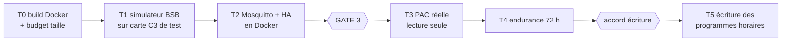

# 08 — Plan de migration vers l'ESP32-C3 SuperMini

> **Résumé**
> Réduction par **gardes `#if`/`#ifndef` nommées `NO_…`**, sur le modèle de `NO_TLS` qui existe déjà. Elles sont inactives par défaut, donc sans effet sur l'amont, et activées dans **notre** `BSB_LAN_config.h`. Une partie du gain s'obtient même sans toucher au code : `NO_TLS`, `MAX_HEATINGTBL`, broches du bus.
> **Sécurité d'abord** : lecture seule forcée à la compilation (`FORCE_READ_ONLY`), routes `/Y` `/YR` `/JY` `/G` retirées, mot de passe de l'AP de secours sorti du code.
> Build de référence **arduino-cli en Docker**, versions figées. Fichiers propres au projet dans `alfea/` et `docker/` ; secrets hors dépôt.
> 10 étapes, un commit chacune, build vert exigé. Tests : build CI → simulateur de bus (Python) → Mosquitto + HA en Docker → PAC réelle en lecture seule (GATE 3).
> **Amendements après la GATE 2** : firmware compilé avec la **liste réduite** (96 entrées, 08a §5.4) ; 40 paramètres journalisés pour HA ; **écriture des programmes horaires, des modes et des consignes** (CC1, CC2, ECS) possible, mais **désactivée par défaut** et limitée par une liste blanche (§5.2) ; broker Mosquitto en add-on HA OS (§5.3).

Conventions : **[CONSTATÉ]**, **[SUPPOSÉ]**, **[À VÉRIFIER]**, **[MESURÉ]**.

---

## 1. Stratégie de réduction

### 1.1 Choix : désactivation par `#define` (et non suppression)
- **Diff minimal** : une garde ajoute 2 lignes (`#ifndef NO_X` / `#endif`) autour d'un bloc existant, sans le déplacer. Un `git rebase` sur une nouvelle version amont ne conflicte que si ce bloc précis a changé.
- **Réversible** : retirer le `#define` dans la configuration rétablit le comportement amont, sans revert.
- **Proposable en amont** : la convention `NO_…` est déjà celle de l'amont (`NO_TLS`, `BSB_LAN/BSB_LAN.ino`). Les gardes de sécurité (`FORCE_READ_ONLY`, `NO_RAW_TELEGRAMS`) intéressent tous les utilisateurs.
- Supprimer du code donnerait au mieux le même gain flash (le compilateur élimine déjà ce qui n'est pas référencé) pour un diff bien plus gros.

### 1.2 Ce qui ne demande aucune modification du code amont [CONSTATÉ]
| Levier | Mécanisme | Gain |
|---|---|---|
| `#define NO_TLS` | existe (`BSB_LAN/BSB_LAN.ino`, 3 occurrences) | ≥ 56 Ko (bundle de CA) + client TLS ≈ 100-120 Ko [ESTIMÉ, 05 §3] |
| `#undef MAX_HEATINGTBL` / `#define MAX_HEATINGTBL 1` | prévu par le commentaire de `BSB_LAN/BSB_LAN.ino:172` ; `BSB_LAN_config.h` est inclus juste après (`:176`), donc peut redéfinir la macro | **≈ 16 Ko de RAM** (500 × 32 o) [MESURÉ en 05] ; `/QDB` devient inutilisable, `/QD` reste disponible |
| `bus_pins[2] = {6, 7}` | `BSB_LAN/BSB_LAN_config.h.default:125`, lu par `BSB_LAN/BSB_LAN.ino:7910-7912` | brochage SuperMini sans `#if` de carte |
| `LoggingMode`, `log_parameters[]`, `mqtt_*` | variables de configuration | MQTT + discovery restreinte (04 §4) |
| `DHT_Pins[0] = 5` | `BSB_LAN/BSB_LAN_config.h.default:221` | DHT22 sur GPIO5 (D5) |
| `enable_version_check = false` | défaut amont | pas d'appel sortant vers bsb-lan.de |
| `#define LED_BUILTIN 8` | l'amont ne le fixe que pour les cartes Olimex (`BSB_LAN/BSB_LAN.ino:211-217`) | LED du SuperMini (09 §3) |

### 1.3 Gardes à ajouter

| Macro | Bloc gardé | Motif | Gain attendu |
|---|---|---|---|
| **`FORCE_READ_ONLY`** | `programIsreadOnly()` (`BSB_LAN/BSB_LAN.ino:1376`) retourne `true` ; `programWriteMode` forcé à 0 après le chargement de la configuration et ignoré à l'enregistrement de `/C` et `/JW` ; envoi des INF (10000-10002) refusé [À VÉRIFIER pendant l'implémentation : chemin INF] | sécurité PAC (00 §2.4) | ~0 |
| **`NO_RAW_TELEGRAMS`** | `/YR` (`:5630`), `/Y` (`:5676-5744`), `/JY` (`:5804-5862`) | contournement de la lecture seule (01 §5, 03) | ≈ 2 Ko [ESTIMÉ] |
| **`NO_GPIO_URL`** | `/G` (`:6840-6884`) | pilotage arbitraire de GPIO, y compris TX et les broches de strapping | < 1 Ko |
| **`AP_PASSWORD`** (valeur) | `WiFi.softAP("BSB-LAN", "BSB-LPB-PPS-LAN")` (`:7669`, `:7675`) | mot de passe public | 0 |
| **`NO_LOGGING_FS`** | journal SD/LittleFS, `/D*`, `/DG`, `graph_html`, montage du FS (`:4312-4516`, `:6379-6562`, `:7052-7230`) | usure flash, HA historise | ≈ 75 Ko [MESURÉ, somme des composants, 05 §3] |
| **`WRITE_WHITELIST`** | dans `programIsreadOnly()` : si l'écriture est activée, seules les lignes de la liste blanche sont modifiables (programmes horaires, modes, consignes : §5.2). Toute autre ligne reste en lecture seule, quel que soit `programWriteMode` | écriture limitée au besoin exprimé (§5.2) | ~0 |
| `NO_ONEWIRE`, `NO_BME280`, `NO_MAX_CUL`, `NO_IPWE`, `NO_UDP_LOG`, `NO_AVERAGES` | modules non utilisés (05 §2) | surface et flash | ≈ 25-35 Ko [MESURÉ partiel / ESTIMÉ] |

**Non gardés** : PPS (≈ 4 Ko pour un diff important et dispersé), Ethernet (à mesurer d'abord : sur C3, le code LAN8720 peut déjà être éliminé), **DHT22 (conservé, D5 ; 1 594 o)**, page `/C` (allégement cosmétique sans gain significatif).

**Correctif amont proposé** : la condition IP de confiance (`BSB_LAN/BSB_LAN.ino:4673-4674`) rejette un client seulement s'il diffère des **deux** adresses, chacune non nulle. Si une seule adresse est configurée, la seconde vaut 0 et **personne n'est rejeté**. Correctif : refuser si au moins une adresse est configurée et qu'aucune ne correspond. Modification de 2 lignes, testée sur simulateur.

### 1.4 Budget visé
| Configuration | Flash | Marge OTA | RAM statique |
|---|---|---|---|
| Amont, liste par défaut [MESURÉ] | 1 610 749 o (81 %) | 19 % | 65 624 o |
| Amont, nouvelle liste 912 entrées [MESURÉ, 08a §5.3] | 1 697 285 o (86 %) | 14 % (**> seuil de 85 %**) | 65 624 o |
| Amont, **liste réduite** 96 entrées [MESURÉ, 08a §5.4] | 1 638 533 o (83 %) | 17 % | 65 624 o |
| **Cible** (gardes + `NO_TLS` + `MAX_HEATINGTBL 1` + liste réduite) | **≤ 65 %** visé [ESTIMÉ] | ≥ 35 % | ≤ 50 Ko |

Critère bloquant : image ≤ 85 % de la partition `app0` (1 966 080 o), contrôlé par le script de build.

## 2. Étapes, validation et commits

Chaque étape = un commit ; « build vert » = compilation Docker C3 sans erreur et rapport de taille joint au message de commit.

| # | Étape | Fichiers | Validation | Commit prévu |
|---|---|---|---|---|
| E0 | Image Docker de build : debian:trixie-slim, arduino-cli et core esp32 **3.3.12** figés, `docker/build.sh` (FQBN, partition, `.bin`, `.map`, rapport de taille) | `docker/arduino-cli/Dockerfile`, `docker/build.sh`, `docs/claude/README_docker.md` | build de l'amont **identique au mesuré** : 1 610 749 o / 65 624 o | `build(docker): image arduino-cli figée pour ESP32-C3` |
| E1 | Configuration Alféa : `alfea/config/BSB_LAN_config.h` (dérivée du `.default`), secrets dans `alfea/config/alfea_secrets.h` **ignoré par git** (modèle `.example` versionné), copie de la configuration et de la liste dans un **répertoire de build temporaire** (l'arbre `BSB_LAN/` reste intact) | `alfea/config/*`, `.gitignore`, `docker/build.sh` | build vert ; aucun secret dans `git grep` | `feat(alfea): configuration ESP32-C3 SuperMini et liste réduite 211/127` |
| E2 | `FORCE_READ_ONLY` (par défaut) et `WRITE_WHITELIST` | `BSB_LAN/BSB_LAN.ino`, config | build vert ; simulateur, lecture seule : `/S710=…` et `/S501=…` refusés, aucun SET ni INF émis ; écriture activée : `/S501=06:00-22:00` et `/S710=20.5` émettent un SET correct, `/S7131=…` ou `/S6711=…` restent refusés | `feat(securite): lecture seule par défaut et liste blanche d'écriture` |
| E3 | `NO_RAW_TELEGRAMS`, `NO_GPIO_URL` | `BSB_LAN/BSB_LAN.ino` | build vert ; `/JY`, `/Y`, `/YR`, `/G` répondent comme une commande inconnue | `feat(securite): retrait des routes de télégrammes bruts et GPIO` |
| E4 | `AP_PASSWORD` + correctif de l'IP de confiance | `BSB_LAN/BSB_LAN.ino`, config | build vert ; AP de secours avec le mot de passe des secrets ; test des IP de confiance (1 et 2 adresses) | `fix(securite): mot de passe AP configurable et filtre IP de confiance` |
| E5 | `MAX_HEATINGTBL 1`, `NO_TLS` (configuration seule) | `alfea/config/BSB_LAN_config.h` | gain RAM ≈ 16 Ko, gain flash mesuré | `perf(alfea): NO_TLS et table QDB minimale` |
| E6 | `NO_LOGGING_FS` | `BSB_LAN/BSB_LAN.ino`, `include/*.h` | build vert ; gain mesuré ; démarrage sans montage de FS | `perf(alfea): journalisation fichier désactivable` |
| E7 | Modules optionnels (`NO_ONEWIRE`…) | idem | build vert ; DHT22 toujours présent | `perf(alfea): modules capteurs et journaux non utilisés désactivables` |
| E8 | Simulateur de bus BSB | `alfea/tools/bsb_sim.py`, doc | réponses aux QUR de la liste HA à partir de valeurs définies, CRC valides (vecteur de 02 : `0x3F7B`) | `test(alfea): simulateur de régulateur BSB` |
| E9 | Pile HA de test : Mosquitto + Home Assistant en Docker Compose | `docker/ha-test/compose.yaml`, `mosquitto.conf` | entités découvertes, valeurs du simulateur affichées, disponibilité `online`/`offline` | `test(docker): pile Mosquitto et Home Assistant de test` |
| E10 | Rapport de taille final + journal | `docs/claude/10_journal_implementation.md` | tableau avant/après par étape | `docs(claude): journal d'implémentation et rapport de taille` |

L'ordre met la **sécurité avant l'optimisation** : à partir de E4, le firmware peut être flashé sur une carte de test sans risque pour une PAC.

## 3. Environnement de build (décision D2 : arduino-cli)

- Image figée : arduino-cli (version épinglée), core `esp32:esp32@3.3.12`, aucune bibliothèque externe (tout est dans `BSB_LAN/src/`).
- FQBN : `esp32:esp32:esp32c3:PartitionScheme=min_spiffs,CDCOnBoot=cdc` (deux partitions app de 1 920 Ko pour l'OTA, `Serial` sur l'USB natif). Le `#error` de partition (`BSB_LAN/BSB_LAN.ino:179`) est satisfait sans `CUSTOM_PARTITION_TABLE`.
- Sorties : `.bin` fusionné (flash à 0x0), `.bin` d'application (OTA), `.map`, `size.txt`. Le script de mesure de 05 (`mapsize.py`) passe dans `alfea/tools/`.
- Commande type : `docker run --rm -v "$PWD:/work" bsblan-build:3.3.12 /work/docker/build.sh`.
- PlatformIO : non retenu (D2). L'environnement `env:esp32c3_alfea` demandé par la mission (00 §7.3) est remplacé par le FQBN ci-dessus ; il pourra être ajouté plus tard sans toucher au code.

## 4. Configuration et secrets

| Élément | Où | Versionné ? |
|---|---|---|
| Brochage, bus BSB, adresse 0x42, langue FR, MQTT (préfixe, mode 1, unités HA, `replaceDisabled "None"`), liste HA, intervalle, DHT22, `NO_*`, `FORCE_READ_ONLY` | `alfea/config/BSB_LAN_config.h` | oui |
| SSID et mot de passe WiFi, hôte/identifiants MQTT, `USER_PASS` (HTTP + OTA), `AP_PASSWORD` | `alfea/config/alfea_secrets.h`, inclus via `__has_include` | **non** (`.gitignore`) ; modèle `alfea_secrets.h.example` versionné |

- `UseEEPROM = 1` (défaut, `BSB_LAN/BSB_LAN_config.h.default:23`) : les valeurs du fichier servent **au premier démarrage**, puis la NVS fait foi. On peut ensuite ajuster depuis `/C`, mais `programWriteMode` est ignoré tant que `FORCE_READ_ONLY` est défini.
- `USER_PASS` **obligatoire** : il protège aussi l'OTA (`BSB_LAN/BSB_LAN.ino:1842-1860`). Le build échoue s'il est vide (`#error` dans notre configuration).
- **Activation de l'écriture** (programmes horaires, modes, consignes) : deux actions explicites, recompiler sans `FORCE_READ_ONLY` **et** passer `programWriteMode` à 1 dans `/C`. La liste blanche (`WRITE_WHITELIST`, §5.2) borne ce qui devient modifiable : les paramètres à risque de 08a I5 (7131 ramonage, 7700-7717 tests de relais, 6710/6711, 5072…) restent **hors liste**, et sont de toute façon absents de la liste réduite.

## 5. Paramètres pour Home Assistant (validés à la GATE 2)

### 5.1 Mesures journalisées
**40 entrées** dans `log_parameters[]` (`BSB_LAN/BSB_LAN_config.h.default:162`), interrogées toutes les `log_interval` secondes et publiées en MQTT. On porte le tableau à **48 places** dans notre configuration pour garder de la marge : sa taille est lue par `sizeof` (`BSB_LAN/BSB_LAN.ino:479`, `BSB_LAN/BSB_LAN_EEPROMconfig.h:218`), donc sans toucher au code.

**Discovery** : la liste réduite joue désormais le rôle de filtre. On active `CF_LOGMODE_MQTT` **sans** `CF_LOGMODE_MQTT_ONLY_LOG_PARAMS` : la discovery couvre les 96 entrées de la liste (04 §2.2), y compris les programmes horaires, qui ne figurent pas dans `log_parameters`. Toute lecture, quelle que soit son origine, est publiée. En lecture seule, les entrées deviennent des `sensor` ou `binary_sensor` (04 §2.4).

| Groupe | Lignes | Libellé (liste 211/127) | Type | Remarque |
|---|---|---|---|---|
| Extérieur | 8700 | Température extérieure | °C | |
| CC1 | 8740, 8741 | Température ambiante réelle / consigne ambiante actuelle CC1 | °C | 8740 vient de la sonde A59 |
| CC1 | 8743, 8744 | Température de départ / consigne de départ résultante CC1 | °C | |
| CC2 | 8770, 8771, 8773 | Ambiante, consigne ambiante, départ CC2 | °C | CC2 confirmé : chambres. CC1 : salon et cuisine |
| PAC | 8410, 8411, 8412 | Retour PAC, consigne PAC, départ PAC | °C | |
| PAC | 8400 | État compresseur 1 | on/off | |
| PAC | 8413 | Modulation compresseur | % | |
| PAC | 8460 | Débit pompe à chaleur | l/min | |
| Appoint | 8402, 8403 | Résistances électriques départ 1 et 2 | on/off | consommation électrique cachée |
| ECS | 8830, 8831 | Température ECS haut (B3), consigne actuelle ECS | °C | |
| ECS | 8821 | Résistance électrique ECS | on/off | |
| États | 8000, 8001, 8003, 8006 | États CC1, CC2, ECS, PAC | ENUM | texte « code - libellé » |
| Modes | 700, 1000, 1600 | Mode CC1, CC2, ECS | ENUM | lecture seule |
| Consignes | 710, 712, 1010, 1012, 1610 | Confort et réduit CC1 et CC2, nominale ECS | °C | (pas 10067-10070 : I8) |
| Énergie | 3113.1, 3113.2, 3113.4 | Énergie chauffage, ECS, totale (#831) | kWh | pas de `state_class` pour les kWh (04 §2.4) : le tableau Énergie de HA demandera un `customize` `total_increasing` ; 3113 si I1 levé |
| Compteurs | 8450, 8451 | Heures et démarrages compresseur | h, n | usure ; 8451 marqué OEM (lisible) |
| Défauts | 6700, 6708 | Erreur, message d'erreur PAC | ENUM | |
| DHT22 | 20100.1, 20100.2 | Température, humidité | °C, % | capteur local (D5), emplacement à définir |

**Charge du bus** (8O1, 11 bits par octet, 2,29 ms par octet, 02 §1.3) : QUR de 11 o = 25 ms, réponse de 14 o ≈ 32 ms, attente de bus libre 63-82 ms (02 §1.3 et §2.3), soit **≈ 130 ms + latence du régulateur** par paramètre. 38 paramètres du bus prennent ≈ 4,9 s, donc **≈ 8 % du temps de bus** avec `log_interval = 60 s`. L'IHM interroge aussi le régulateur en permanence (08a §1) : ne pas descendre sous 30 s sans mesure.

### 5.2 Programmes horaires (demande de l'utilisateur)

| Programme | Lignes (lundi → dimanche) | CmdID du lundi | Accès (dump, `id4`) |
|---|---|---|---|
| CC1, salon + cuisine | 501-507 | `0x053D0A8C` | 0x11 : utilisateur final |
| CC2, chambres | 521-527 | `0x063D0A8C` | 0x11 |
| ECS | 561-567 | `0x053D0AA0` | 0x11 |

- **Format** (`VT_TIMEPROG`, `BSB_LAN/BSB_LAN.ino:3358-3385`) : jusqu'à 3 plages par jour, par exemple `06:00-08:00 17:00-22:30`. Les plages absentes sont envoyées comme désactivées (`0x80`). Le pas des minutes accepté par le régulateur n'est pas connu [À VÉRIFIER : 10 ou 15 min sur l'IHM].
- **HA** : un programme modifiable devient une entité `text` (04 §2.4) : on saisit la chaîne, BSB-LAN envoie le SET, relit le paramètre et publie la nouvelle valeur. Une carte de tableau de bord plus confortable sera proposée en Phase 5.
- **Rafraîchissement** : les programmes ne sont pas journalisés toutes les minutes (21 lectures inutiles). Une automatisation HA les relit via le topic `<préfixe>/poll` (04 §1.4) toutes les 15 min et au démarrage, ce qui suffit pour voir une modification faite depuis l'IHM.
- **Question ouverte (P7)** : le dump montre aussi des programmes **cachés** de niveau 6 (`0x053D1B4E`… pour CC1, `0x063D…` pour CC2, `0x073D…` pour CC3 ; lignes 10020-10040 de la liste). Ce sont probablement ceux de l'IHM Atlantic [SUPPOSÉ]. Si l'IHM pilote la PAC avec ses propres programmes et réécrit 501-567, une modification depuis HA serait écrasée ou sans effet. À trancher en lecture seule à la mise en service : comparer 501-507, 10020-10026 et l'affichage de l'IHM. Ils sont dans la liste réduite pour cette raison, en **lecture seule**.

> ⚠️ **Avertissement : écriture sur la PAC.**
> Paramètres modifiables une fois l'écriture activée, **et seulement eux** : **501-507, 521-527, 561-567** (programmes horaires), **700, 1000, 1600** (modes CC1, CC2, ECS), **710, 712, 1010, 1012, 1610** (consignes confort/réduit CC1 et CC2, consigne nominale ECS). Restent exclus : ECS forcée (5072), dérogations (701.x), ramonage (7131), tests de relais (7700-7717), remises à zéro (6710/6711), hors-gel (714), courbes de chauffe, limites et paramètres OEM.
> Effet d'une erreur : une consigne ou un mode erroné peut surchauffer ou laisser refroidir une zone, ou couper l'eau chaude jusqu'à la correction. Le régulateur borne lui-même les consignes à ses plages internes (ex. 710 entre 712 et la limite de confort) [SUPPOSÉ : comportement Siemens habituel, à vérifier sur les valeurs refusées]. Je ne connais pas de risque matériel pour ces paramètres de niveau utilisateur (accès `id4` 0x11 à 0x33 dans le dump).
> Côté HA : un mode devient une entité `select` (valeurs de l'énumération), une consigne une entité `text` (la discovery amont ne crée pas d'entité `number`, 04 §2.4). Une entité `climate` composée côté HA est prévue en Phase 5 pour un pilotage plus naturel.
> Conditions : écriture activée **seulement après** la validation en lecture seule (T3, T4) et un accord explicite (§6). **Sauvegarde préalable** des 21 programmes (`/JQ=501-507,521-527,561-567`, enregistrée en JSON). Premier essai sur **un seul jour de CC2**, puis sur la **consigne réduite de CC2 (1012)** de ±0,5 °C, avec relecture et vérification sur l'IHM, et procédure de restauration à partir de la sauvegarde (étendue aux 8 modes et consignes).

### 5.3 Broker MQTT
Home Assistant OS 2026.10 est installé, sans broker. Il faut installer l'add-on officiel **« Mosquitto broker »** (Paramètres → Modules complémentaires), puis créer un **utilisateur HA dédié** à BSB-LAN, dont les identifiants vont dans `alfea_secrets.h`. L'intégration MQTT est alors proposée automatiquement par HA. Le port 1883 en clair sur le réseau local est cohérent avec `NO_TLS` (04 §4). La procédure détaillée ira dans le guide (11) ; la pile de test Docker (E9) utilise le même Mosquitto.

## 6. Stratégie de test

| Niveau | Moyen | Critères |
|---|---|---|
| T0 | build Docker à chaque commit | compile, image ≤ 85 %, rapport de taille |
| T1 | **simulateur** `bsb_sim.py` sur PC, relié aux GPIO 6/7 du C3 par un adaptateur USB-UART 3,3 V **sans optocoupleur**. Il applique l'inversion logicielle des données comme BSB-LAN (`^0xFF`, 8O1, 02 §1.1). Option : banc « bus » 15 V avec deux cartes d'interface pour tester la carte elle-même | réponses décodées et valeurs justes ; refus de SET/INF en lecture seule ; écriture limitée à la liste blanche une fois activée, trame SET de programme horaire conforme à la trace de `BSB_LAN/BSB_LAN.ino:3361` ; routes retirées ; tenue en cas de trame à CRC faux ou de silence |
| T2 | `docker/ha-test` : Mosquitto + HA, alimentés par T1 | entités de la liste réduite découvertes avec unités, disponibilité, reprise après redémarrage du broker (republication de la discovery, 04 §1.1) |
| T3 | PAC réelle, **après GATE 3** : mesure de X86 (09 §8), branchement PAC hors tension, lecture 6220-6229, puis liste HA | aucune trame émise hors QUR (journal USB), IHM sans alarme, valeurs plausibles (comparaison avec l'IHM) |
| T5 | écriture, **après accord explicite** | sauvegarde JSON, un jour de CC2 puis 1012 ±0,5 °C, relecture identique, IHM cohérente, restauration testée ; puis le reste de la liste blanche |
| T4 | 72 h en service | pas de reboot WDT, tas libre stable, RSSI ≥ −70 dBm (condition D1), pas d'erreur bus récurrente |

Docker et le port série : sous Linux, `--device /dev/ttyACM0` ; sous Windows, le simulateur tourne sur l'hôte (Python) ou en WSL via `usbipd`. Le flash se fait avec `esptool` sur l'hôte (détails en 11).

## 7. Risques et repli

| # | Risque | Repli |
|---|---|---|
| P1 | Famille ou variante ≠ 211/127 (08a I9) | dump `/QD` + analyse ; liste du mainteneur si nécessaire. Le firmware reste utilisable : paramètres génériques + `/QD` |
| P2 | Compteurs 3110-3126 illisibles (08a I1) | compteurs #831 ajoutés ; retypage par le générateur après une trace brute |
| P3 | Une garde casse une fonction voisine (code monolithique) | une garde par commit, build et T1 à chaque étape, `git revert` ciblé |
| P4 | Dérive amont (nouvelle version) | gardes de 2 lignes, rebase périodique ; liste et configuration hors de `BSB_LAN/` |
| P5 | RF SuperMini insuffisante | repli prévu en 07 (antenne externe ou kit 4 Mo), même firmware (FQBN identique) |
| P7 | Programmes horaires pilotés par l'IHM (objets cachés, §5.2) | lecture comparée à la mise en service ; si l'IHM fait foi, étudier l'écriture des objets cachés (nouvelle analyse, nouvel accord) ou garder la programmation sur l'IHM |
| P9 | L'IHM réécrit une consigne ou un mode modifié depuis HA (maître actif sur le bus, 08a §1) | observation en T5 ; si c'est le cas, documenter que l'IHM fait foi pour ce paramètre |
| P8 | SET `VT_TIMEPROG` non testé en amont (« TODO test it ») | test sur simulateur, puis sur un seul jour de CC2 avec relecture |
| P6 | Lecture DHT22 : section critique d'environ 5 ms (`portENTER_CRITICAL`, `BSB_LAN/src/DHTesp/DHTesp.cpp:205`) sur un cœur unique | l'UART matériel du C3 garde les octets du bus en FIFO pendant ce temps (≈ 2 octets en 5 ms) [SUPPOSÉ] ; à vérifier en T1 avec bus chargé. Repli : espacer les lectures DHT |
