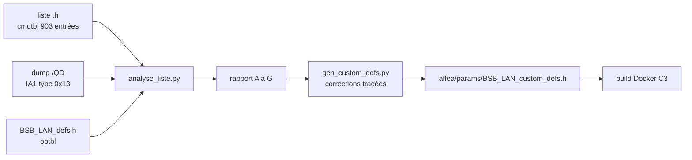

# 08a — Analyse de la liste de paramètres 211/127 et nouvelle liste

> **Résumé**
> La seule liste spécifique RVS21.831F/127 (famille 211, variante 127) que j'ai trouvée publiée est celle de l'issue #622 : **903 entrées**, générée par le mainteneur pour BSB-LAN 3.3. Je l'ai confrontée au dump `/QD` d'une **autre** machine 211/127 (même OV 402.6) : **847 des 882 entrées spécifiques** ont leur objet dans le dump, sans aucun numéro de ligne divergent (hors renumérotation conventionnelle des objets de ligne 0), et les **677 tailles de données contrôlables** sont cohérentes (643 identiques, 34 ENUM sur 2 octets gérés par le décodeur).
> Incohérences réelles : 73 compteurs d'énergie typés « chaîne » (format non vérifié, **dont 3113**), objets cachés absents (#829, #831), 1 objet du dump oublié (5057), 13 objets de niveau d'accès 6 exposés en écriture (dont la **fonction ramonage 7131**), `VT_VACATIONPROG` non inscriptible sur RVS21 (#812).
> La nouvelle liste (`alfea/params/BSB_LAN_custom_defs.h`, 912 entrées) est **générée par script** : 9 ajouts tracés, aucune suppression. Elle **compile** avec BSB-LAN 5.1.34 (§5.3).
> Point bloquant pour la mise en service : votre machine affiche une version applicative 89.006.090. Il faut **confirmer famille et variante (6225/6226)** avant de compter sur cette liste (§6).

Conventions : **[CONSTATÉ]**, **[SUPPOSÉ]**, **[À VÉRIFIER]**. Les numéros de ligne cités sans chemin renvoient aux fichiers de `alfea/params/source/`.

---

## 1. Sources

| Fichier (dans `alfea/params/source/`) | Origine | sha256 | Contenu |
|---|---|---|---|
| `BSB_LAN_custom_defs_211-127_issue622.h` | [issue #622](https://github.com/fredlcore/BSB-LAN/issues/622), pièce jointe `BSB_LAN_custom_defs.h.txt` | `ae0d5c50…6ee9e8` | liste générée par le mainteneur. En-tête l. 1 : `0/RVS21.831F/127/211/127/402.6/146978` (adresse / identification / famille / variante / **OV 402.6** / n° de série) |
| `dump_211-127_issue622.txt` | même issue, `BSB-LAN-211-127-137987.txt` | `1a2dd88c…ee6e6` | dump `/QD` produit par BSB-LAN **3.3.2**, appareil 0 = RVS21.831F/127, n° de série **137987** |

[CONSTATÉ] L'auteur de l'issue dit avoir repris la liste « de son voisin, qui a la même PAC ». Les numéros de série diffèrent (146978 pour la liste, 137987 pour le dump), mais la version OV est la même : la confrontation compare donc **deux machines distinctes de même génération**, ce qui est précisément la situation de votre installation.

[CONSTATÉ] Le dump trouve deux appareils sur le bus : **0** (le RVS21) et **10** (`0x0A`, l'IHM Atlantic), qui répond « Not supported by this device » au dump (dump l. 990-995). On y voit aussi du trafic de l'IHM entre deux requêtes de BSB-LAN (l. 140 et 659) : **l'IHM est un maître actif sur le même bus**, avec lequel BSB-LAN doit cohabiter.

## 2. Méthode



### 2.1 Décodage d'un enregistrement IA1
Le code qui construit `/QDB` (`BSB_LAN/BSB_LAN.ino:5481-5488`) indique la structure des réponses IA1. Exemple, paramètre 642 (dump l. 29) :

```
DC 80 42 19 13 | 00 0E | 15 | 05 09 C4 | 02 82 | 11 | 03 05 80 | 02 | 4E 19 08 00 10 | F8 F9
          type   index  id2   CmdID     ligne   id4             id3                   CRC
```

| Champ | Octet(s) | Signification | Statut |
|---|---|---|---|
| `id2` | 7 | classe de donnée ; donne la taille : 1 o (0x01, 0x02, 0x05, 0x08), 2 o (0x03, 0x06, 0x09), 4 o (0x04, 0x07) | [SUPPOSÉ, validé statistiquement : §3, ligne D] |
| CmdID | 8, 9-10 | `0x05 3D 09 C4` : le 2e octet est toujours `0x3D` (`+ 0x3D0000` dans le code) | [CONSTATÉ] |
| ligne | 11-12 | numéro de ligne Siemens : `0x0282` = 642 | [CONSTATÉ] |
| `id4` | 13 | niveau d'accès : quartet haut = **écriture** (0 = lecture seule), quartet bas = **lecture**. 1 = utilisateur, 2 = mise en service, 3 = chauffagiste, 4 = OEM, 6 = ? | [SUPPOSÉ : la corrélation avec `FL_RONLY`/`FL_OEM` est parfaite, §4 I5] |
| `id3` | 17 | code d'unité : 0x06 = °C mesure, 0x07 = °C consigne d'ambiance, 0x08 = °C départ, 0x0D = %, 0xDA à 0xDC = écarts en K… | [SUPPOSÉ] |

Le dump contient aussi 86 enregistrements IA2 (type 0x15), probablement les textes d'énumération ; leur format n'est pas décodé par BSB-LAN et je ne les ai pas exploités.

### 2.2 Contrôles
Script `alfea/tools/analyse_liste.py` (Python 3 sans dépendance), relançable sur le dump de votre machine :
```
python3 alfea/tools/analyse_liste.py <liste.h> <dump.txt> BSB_LAN/BSB_LAN_defs.h [famille variante]
```
- **A** : entrées de la liste sans objet dans le dump ;
- **B** : objets du dump absents de la liste ;
- **C** : même CmdID, numéro de ligne différent ;
- **D** : taille de la donnée attendue par `optbl` (`payload_length`, hors octet d'activation, `BSB_LAN/BSB_LAN_defs.h:597`) contre taille annoncée par `id2` ;
- **E** : drapeaux (`FL_RONLY`, `FL_OEM`) contre niveau d'accès `id4` ;
- **F** : types structurés non contrôlables (chaînes, dates, programmes horaires) ;
- **G** : libellés partagés.

## 3. Résultats chiffrés [CONSTATÉ, sortie du script]

| Contrôle | Résultat |
|---|---|
| Entrées de la liste | 903 : **882 spécifiques 211/127**, 21 génériques (`255/255` : date/heure, 700/1000/1300/1600, 6224-6227, températures d'ambiance INF 10000-10002, etc.) |
| Enregistrements IA1 du dump | **880** ; index manquants : **56, 125, 644** (perdus pendant le dump, entre les lignes 905/909, 1237/1241 et 8063/8065) |
| A. Liste sans objet dans le dump | 35 : 30 jours de programmes horaires (502-507, 522-527, 542-547, 562-567, 602-607 : seul le lundi est déclaré, les jours suivants ont des CmdID consécutifs), 643/653 (fin de congés : CmdID de début + 1), **908, 1238, 8064 = exactement les 3 trous du dump** → aucune entrée suspecte |
| B. Dump absent de la liste | 31 : **1 vrai paramètre (5057)** + 30 objets internes (lignes 19, 2279, 7175-7177, CmdID `0x0n3D0n01`) [SUPPOSÉ : objets de service du bus, non documentés] |
| C. Numéro de ligne différent | **0** (hors 52 objets de ligne 0 que le mainteneur renumérote en 10020-10075 par convention) |
| D. Taille de donnée | **643 concordantes**, 34 discordantes, toutes des ENUM sur 2 octets (états 8000-8025, erreurs 6700-6819, historiques 8051-8069), **correctement gérées** par le décodeur (`BSB_LAN/include/print_telegram.h:1166-1175`, cas `data_len == 3`) |
| E. Accès contre drapeaux | 795 couples (entrée, objet) : cohérence totale pour 781 ; 13 cas de niveau 6 et 1 cas atypique (§4 I5) |
| F. Non contrôlables | `VT_STRING` 73, `VT_DATETIME` 21, `VT_VACATIONPROG` 4, `VT_UNKNOWN` 3, `VT_LPBADDR` 1 |
| G. Libellés partagés | 71 libellés pour 173 entrées (CC1/CC2/CC3, doublons de ligne 0) |

**Conclusion** : la liste est **fidèle au régulateur** pour la structure (CmdID, numéros, tailles, droits). Les défauts portent sur ce que le dump ne montre pas (objets cachés, format des compteurs) et sur deux choix de typage ou de droits.

## 4. Incohérences relevées

| # | Constat | Gravité pour nous (lecture seule) | Action dans la nouvelle liste |
|---|---|---|---|
| **I1** | **73 compteurs typés `VT_STRING`** (`id2 = 0x12`) : chaleur fournie 3110, **énergie utilisée 3113**, chaleur par usage 3121-3126, COP et dates de relevé… Or `VT_STRING` affiche `-` si le 1er octet de la charge utile vaut 0 (`print_telegram.h:1239-1248`). Si ces objets renvoient « octet d'activation 0 + entier », comme les compteurs de l'issue #831, **ils s'afficheront `-`**. [À VÉRIFIER : aucune trace brute de 3113 publiée] | **haute** : ce sont les compteurs d'énergie qu'on veut dans HA | type **inchangé** (format inconnu). Compteurs de #831 ajoutés en parallèle (I2). Trace brute de 3113 à capturer à la mise en service (§6) |
| **I2** | Objets **cachés** (non déclarés en IA1) utilisés par l'IHM et absents de la liste : dérogation temporaire écart/durée `0x053D1AA6`/`0x053D1AA5` (#829, CC2 en `0x06…`) ; compteurs d'énergie par usage `0x053D1094/1095/1B7E/1082` (#831, trace `00 00 00 7F 21` = 32 545 kWh) | moyenne : données utiles pour HA | **ajoutés** : 701.3, 701.4, 1001.3, 1001.4, 3113.1 à 3113.4 |
| **I3** | Objet **5057** présent dans le dump (`0x313D0714`, 1 octet, écriture niveau 3) mais absent de la liste | faible | **ajouté** en `VT_BYTE` lecture seule, libellé « non documenté » |
| **I4** | `VT_VACATIONPROG` a `enable_byte = 6` (`BSB_LAN/BSB_LAN_defs.h:985`) : le RVS21 **refuse** l'écriture de 642/643/652/653 et attend 1 ; l'effacement (`---`) est refusé quelle que soit la valeur (PR #812, fermée sans fusion) | nulle en lecture seule (la lecture fonctionne, octet 0 = 0) | hors liste (table globale). À traiter **si** l'écriture est un jour activée |
| **I5** | Niveau d'accès **6** traité comme « utilisateur » (`DEFAULT_FLAG`, modifiable) pour 13 objets : 701/1001/1301 (+ .1, .2, dérogation), 5072 (forçage ECS), **7131, 7131.1, 7131.2 (fonction ramonage)**. Plus 6710 (`id4 = 0x24`, écriture niveau 2 mais lecture niveau 4 : atypique) | nulle en lecture seule ; **à risque** si l'écriture est activée : 7131 force la production de chaleur | aucune modification (la lecture seule globale protège). Recommandation 08 §4 : liste blanche d'écriture le jour où on l'active |
| **I6** | Écarts de température (`id3` 0xDA-0xDC, 31 entrées : 721, 830, 920…) typés `VT_TEMP`, donc affichés en °C au lieu de K | cosmétique (HA les classerait `temperature`) | aucune ; ces paramètres ne sont pas proposés pour HA |
| **I7** | Libellés : 71 libellés partagés, fragments anglais (« Temporarily warmer », « Event message », « Min flow switch consomm »), vocabulaire chaudière (« brûleur », « chaudière ») sur une PAC, coquille « Sous-refrodissement » | cosmétique : le nom d'entité HA contient le numéro de ligne, donc reste unique (04 §2.3) | aucune (diff minimal avec la liste du mainteneur) ; renommage dans HA |
| **I8** | Mêmes CmdID sous deux numéros : 710/10067, 712/10068, 714/10069, 851/10071, 1610/10070, 7131/10072, 8740/10049 (objets de ligne 0 du dump) | faible : doublerait les lectures si les deux numéros sont journalisés | aucune ; la sélection HA (08 §5) n'en prend qu'un |
| **I9** | **Provenance** : liste et dump viennent de machines OV 402.6 ; votre IHM affiche « RVS21 - 89.006.090 », valeur qui n'apparaît nulle part dans la liste. BSB-LAN ne retient une entrée que si famille **et** variante correspondent (`BSB_LAN/BSB_LAN.ino:1205`) : si votre régulateur n'est pas 211/127, **les 882 entrées spécifiques seront invisibles** | **bloquante si elle se réalise** | procédure §6 |
| ~~I10~~ | **Retiré après vérification.** J'avais noté que `findLine()` s'arrête à `j < active_cmdtbl_size - 1` (`BSB_LAN/BSB_LAN.ino:1160`) et ne trouverait jamais la dernière entrée. En fait, la table active se termine toujours par la sentinelle `CMD_END` (ligne 65535, `BSB_LAN/BSB_LAN_defs.h:1486`) : la borne est voulue | — | — |

## 5. Nouvelle liste

### 5.1 Principe
- Génération **reproductible** : `alfea/tools/gen_custom_defs.py` lit la liste source, insère les ajouts à leur place (la table doit rester groupée par numéro de ligne, cf. la boucle `while (l == line)` de `BSB_LAN/BSB_LAN.ino:1198`) et écrit `alfea/params/BSB_LAN_custom_defs.h`.
- **Aucune suppression ni modification** d'entrée source : la liste reste comparable ligne à ligne à celle du mainteneur. Chaque ajout porte le commentaire `ALFEA`.
- Les drapeaux d'écriture d'origine sont conservés : la protection en écriture est assurée globalement par le firmware (08 §3, lecture seule forcée à la compilation).

### 5.2 Ajouts

| Ligne | CmdID | Type | Drapeaux | Source | Libellé |
|---|---|---|---|---|---|
| 701.3 / 1001.3 | `0x053D1AA6` / `0x063D1AA6` | `VT_TEMP` | `DEFAULT_FLAG` | #829 (testé par son auteur) | Dérogation temporaire : écart de consigne |
| 701.4 / 1001.4 | `0x053D1AA5` / `0x063D1AA5` | `VT_HOURS_SHORT` | `DEFAULT_FLAG` | #829 | Dérogation temporaire : durée |
| 3113.1 à 3113.4 | `0x053D1094`, `1095`, `1B7E`, `1082` | `VT_ENERGY` (4 o, kWh, `BSB_LAN/BSB_LAN_defs.h:973`) | `FL_RONLY` | #831 (trace brute fournie) | Énergie utilisée chauffage / ECS / rafraîchissement / totale |
| 5057 | `0x313D0714` | `VT_BYTE` | `FL_RONLY` | dump (I3) | Paramètre ECS 5057 (non documenté) |

Les ajouts tombent dans les plages de catégories existantes (`ENUM_CAT_NR`, l. 2146 et suivantes) : 700-900 (CC1), 1000-1200 (CC2), 3090-3267 (compteurs), 5012-5700 (ECS).

### 5.3 Vérification par compilation [MESURÉ]
Build Docker jetable identique à celui de 05 (arduino-cli, core esp32 3.3.12, `esp32c3`, `min_spiffs`), amont **non modifié**, seul `BSB_LAN_custom_defs.h` remplacé :

| Liste | Flash | RAM statique | Résultat |
|---|---|---|---|
| Liste par défaut (rappel 05) | 1 610 749 o (81 %) | 65 624 o | OK |
| Liste source #622 (903 entrées) | 1 696 693 o (**86 %**) | 65 624 o | compile sans erreur ni modification du code |
| **Nouvelle liste (912 entrées)** | **1 697 285 o (86 %)** | 65 624 o | compile sans erreur ni modification du code |

- La liste complète coûte **+85 944 o de flash** par rapport à la liste par défaut (≈ 94 o par entrée, libellés et énumérations compris) et **0 o de RAM** (tables en flash). L'estimation de 07 (+50 à +100 Ko) est confirmée.
- Les 9 ajouts coûtent 592 o.
- À 86 %, l'image amont avec cette liste **dépasse le seuil de 85 %** fixé en 08 §1.4 : la réduction de la Phase 4 (`NO_TLS`, `NO_LOGGING_FS`…) est donc nécessaire, et non plus seulement souhaitable.
- Build : image Docker jetable (debian:trixie, arduino-cli, `esp32:esp32@3.3.12`), copie de l'amont hors dépôt, FQBN `esp32:esp32:esp32c3`, `PartitionScheme=min_spiffs,CDCOnBoot=cdc`.

### 5.4 Liste réduite (demande de l'utilisateur après la GATE 2)

**Faut-il garder tous les paramètres du dump ? Non.** BSB-LAN ne peut lire ou écrire que les paramètres présents dans sa table (`cmdtbl`). Ce qui n'y est pas reste inaccessible, mais rien ne casse : le dump `/QD` fonctionne sans la liste. On peut donc ne compiler que ce qui sert.

| Liste | Entrées | Flash (C3) | Écart |
|---|---|---|---|
| par défaut de l'amont | 18 | 1 610 749 o (81 %) | référence |
| complète 211/127 (§5.2) | 912 | 1 697 285 o (86 %) | +85 944 o |
| **réduite** (`selection_ha.txt`) | **96** | **1 638 533 o (83 %)** | **−58 752 o** par rapport à la complète [MESURÉ] |

- Générée par `gen_custom_defs.py … --selection alfea/params/selection_ha.txt` → `alfea/params/BSB_LAN_custom_defs_ha.h`.
- Contenu : date/heure (0-3), identification (6220-6229), **programmes horaires** CC1 501-507, CC2 521-527, ECS 561-567, programmes cachés 10020-10033 (à comparer à l'IHM, 08 §5.2), modes et consignes CC1/CC2/ECS, températures, états, compteurs, défauts.
- Les 28 Ko restants par rapport à la liste par défaut viennent surtout de la table de textes des **codes d'erreur** `E6700_0` (≈ 31 Ko de source, partagée par 6700 et 6701) [ESTIMÉ d'après la taille du source] : elle sert à afficher l'erreur en clair dans HA, je la garde.
- Les deux listes restent générées : la complète sert au diagnostic (page web, recherche d'un paramètre), la réduite est celle du firmware par défaut. **Ajouter un paramètre = une ligne dans `selection_ha.txt`**, puis régénérer et recompiler.
- Entrées génériques supprimées par la sélection : 10000-10002, 10018-10019, 10110-10112 (télégrammes INF en écriture seule), ce qui réduit aussi la surface d'écriture.

## 6. Validation sur votre machine (à la mise en service, en lecture seule)

Sans risque : uniquement des requêtes de lecture (`QUR`).

1. Lire **6220-6229** (`/6220-6229`) : version logicielle, indice, **6224** (identification, ex. « RVS21.831F/127 »), **6225** (famille), **6226** (variante), 6227 (version OV).
2. Si 6225/6226 ≠ 211/127 : la liste ne s'affichera pas (I9). Faire un dump `/QD` avec le firmware actuel (qui réessaie les enregistrements perdus, `BSB_LAN/BSB_LAN.ino:5434-5476`), puis relancer `analyse_liste.py … <famille> <variante>`. Selon l'écart, soit adapter la famille et la variante de la liste par script (si le dump est identique), soit envoyer le dump au mainteneur (procédure officielle).
3. Si 211/127 : relancer quand même l'analyse sur votre dump pour détecter des écarts de version (89.006.090).
4. Lever **I1** : lire 3113 et 3113.4 avec le journal de débogage USB actif et noter la trame brute de 3113. Si 3113 affiche `-` alors que 3113.4 donne une valeur en kWh, retyper les compteurs `0x12` en `VT_ENERGY` (correction à ajouter au générateur).

## 7. Limites
- Une seule machine de référence (dump d'un tiers) ; les IA2 ne sont pas décodés, donc les **valeurs d'énumération** ne sont pas vérifiées.
- Les objets cachés ne sont découvrables qu'en observant le trafic IHM ↔ régulateur (ce qu'ont fait les auteurs de #829 et #831) ; d'autres peuvent manquer.
- Les significations de `id2`, `id3` et `id4` sont des déductions statistiques, pas une documentation Siemens.
