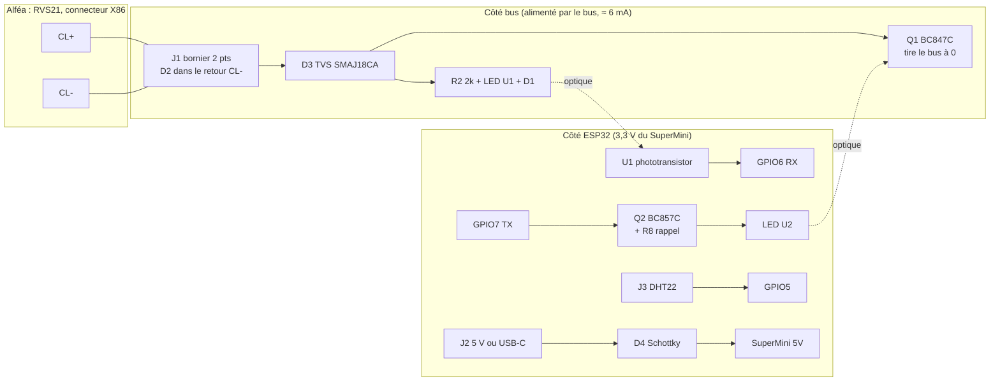

# 09 — Design de la carte d'interface BSB pour ESP32-C3 SuperMini

> **Résumé**
> Carte porteuse 2 couches de **66 × 33 mm** (§6), **placée et routée à la main par l'utilisateur** : J1 et le SuperMini sur le même axe, borniers enfichables au pas de 3,5 mm, barrette pour le DHT22, 4N25 en DIP-6, trous M3 aux 4 coins, transistors en SOT-23, composants passifs sous le module. Le SuperMini s'y enfiche (2 × 8 broches au pas de 2,54 mm). Elle reprend **la topologie éprouvée de l'adaptateur officiel V3** : 2 × 4N25, BC547/BC557, mêmes valeurs. Les **écarts sont limités et justifiés** : rappel de TX au démarrage, transistor de bus en gain C, TVS sur l'entrée (PTC retirée, §7), R2 à 2 kΩ, retrait de l'EEPROM, entrée DHT22 protégée, entrée 5 V avec diode anti-retour.
> **Isolation galvanique conservée** : rien n'est prélevé sur le bus pour l'ESP32. L'alimentation vient d'un **chargeur USB 5 V** (défaut, aucune intervention sur le 230 V) ou d'un module 5 V rail DIN (option).
> Brochage : RX = GPIO6, TX = GPIO7, DHT22 = GPIO5, LED = GPIO8 (sur le SuperMini). **Projet KiCad 9 dans `alfea/hardware/carte_bsb_c3/`** : le schéma principal est celui retouché dans KiCad (émission conforme à V3, §2.3) ; PCB routé par l'utilisateur, plan de masse côté ESP32 ; ERC 0, DRC 0 (toutes sévérités), parité 0, isolation bus/ESP32 ≥ 5,2 mm (§7, §9). Gerber produits par l'utilisateur.
> **X86 mesuré** (§8, 2026-11-04) : **11,5 V entre 1 et 2, 11,6 V entre 2 et 3** ; la première mesure (0 V) avait été prise sur les têtes de vis. R2 = 2 kΩ reste dans la règle (> 11 V). Restent à confirmer avant branchement : la polarité et laquelle de 1 ou 3 porte CL+.

Conventions : **[CONSTATÉ]**, **[SUPPOSÉ]**, **[À VÉRIFIER]**. Les calculs reprennent les valeurs de 06 §3 (4N25 : CTR ≥ 20 % à 10 mA, Vf 1,2 V ; C3 : V_IH ≥ 2,48 V, V_IL ≤ 0,83 V).

---

## 1. Schéma fonctionnel



Aucun conducteur ne traverse la frontière bus/ESP32 : les deux seuls chemins sont optiques (U1 en réception, U2 en émission).

## 2. Schéma électrique détaillé (netlist)

Nœuds côté bus [CONSTATÉ dans le schéma principal] : `BUS_P` (J1-1 = CL+ ; `CL_P_IN` a disparu avec F1, §7), `BUS_N` (anode de D2), `CL_N_IN` (J1-2 = CL-, cathode de D2). Dans les tableaux, `BUS+` = `BUS_P` et `BUS-` = `BUS_N`. Nœuds côté ESP32 : `+3V3` et `GND` (broches du SuperMini), `+5V`.

### 2.1 Entrée et protections (côté bus)
| Réf. | Valeur | Connexion | Rôle |
|---|---|---|---|
| J1 | bornier à vis 2 pts, pas 2,54 | 1 = CL+, 2 = CL- | raccordement X86 |
| ~~F1~~ | **supprimé** (choix de l'utilisateur, §7) | J1-1 directement sur `BUS+` | comme en V3 ; conséquence en cas d'erreur de câblage : §5 |
| D2 | 1N4148W | anode `BUS-`, cathode `CL_N_IN` | **en série dans le retour CL-** : bloque tout l'étage bus (réception et émission) en cas d'inversion |
| D3 | TVS bidirectionnelle SMAJ18CA (V_RWM 18 V, V_BR ≥ 20 V) | `BUS_P` ↔ `CL_N_IN` (en amont de D2) | surtensions et ESD ; bidirectionnelle pour tolérer une inversion de polarité **[écart]** |

### 2.2 Réception : bus → GPIO6 (identique à V3)
| Réf. | Valeur | Connexion |
|---|---|---|
| R2 | **2 kΩ**, 1206 (250 mW) **[écart : 1,5 kΩ en V3]** | `BUS+` → U1 broche 1 (anode) |
| U1 | 4N25 | 1 anode, 2 cathode → D1 anode ; 5 collecteur → `+3V3`, 4 émetteur → `RX` (GPIO6), 6 base → R4 |
| D1 | LED rouge | D1 cathode → `BUS-` (témoin d'activité du bus) ; D2 (§2.1) est en série dans le retour |
| R4 | 330 kΩ | U1-6 (base) → U1-4 (émetteur) : accélère le blocage |
| R5 | 4,7 kΩ | `RX` → `GND` |

Calcul (06 §3.1) : seuil ≈ 3,7 V aux bornes de X86 = Vf(U1) 1,2 + Vf(D1) 1,8 + Vf(D2) 0,7, inchangé par le déplacement de D2 dans le retour ; Ic nécessaire = 2,48 V / 4,7 kΩ = 0,53 mA, soit I_F ≥ 0,53 / 0,20 = 2,65 mA au CTR minimal.

| R2 | I_F à 12 V / 13 V / 15 V | Marge au CTR min. (12 → 15 V) | Bus minimal pour RX | P(R2) au pire (15 V) |
|---|---|---|---|---|
| 1,5 kΩ (V3) | 5,5 / 6,2 / 7,5 mA | ×2,1 → ×2,8 | 7,7 V | 85 mW |
| **2 kΩ (retenu)** | 4,15 / 4,65 / 5,65 mA | **×1,57 → ×2,1** | **9,0 V** | **64 mW** (1206 : marge ×3,9) |

2 kΩ est un **écart à V3** (choix de l'utilisateur : référence Basic C17944, 1,5 kΩ en 1206 n'existant qu'en Extended). Il charge moins le bus (4,65 mA au lieu de 6,2 mA à 13 V) et reste suffisant pour un niveau haut de 12 à 15 V. **Condition** : le niveau haut réel du bus, mesuré sur X86 (§8), doit dépasser **9 V** avec marge ; le CTR baisse aussi avec le vieillissement de la LED [SUPPOSÉ : −20 à −30 % sur la vie]. Au-dessous de 11 V, revenir à 1,5 kΩ.

### 2.3 Émission : GPIO7 → bus
| Réf. | Valeur | Connexion |
|---|---|---|
| R6 | 4,7 kΩ | `TX` (GPIO7) → base de Q2 |
| **R8** | **10 kΩ** | base de Q2 → `+3V3` **[écart : rappel au démarrage]** |
| Q2 | BC857C (PNP, SOT-23) | E → `+3V3`, C → R3 |
| R3 | 300 Ω | Q2-C → U2 broche 1 (anode) ; U2-2 → `GND` |
| U2 | 4N25 | 5 collecteur → `BUS+`, 4 émetteur → base de Q1, 6 base → R1 |
| R1 | 330 kΩ | U2-6 (base) → U2-4 (émetteur) : accélère le blocage, comme R4 sur U1 |
| R7 | 330 kΩ | base de Q1 → `BUS-` |
| **Q1** | **BC847C** (NPN, SOT-23) | C → `BUS+`, E → `BUS-` **[écart : gain C imposé]** |

Calculs (VCC = 3,3 V) :
- **TX bas** : I_F(U2) = (3,3 − 0,2 − 1,2) / 300 = **6,3 mA**. Ib(Q2) = (3,3 − 0,7) / 4,7 k − 0,7 / 10 k = 0,55 − 0,07 = **0,48 mA** ; Ic = 6,3 mA, β forcé ≈ 13 ≪ β min (420) : saturé. Courant sur la GPIO : 0,55 mA.
- **TX haut ou haute impédance** (reset, bootloader) : R8 maintient V_EB = 0 et Q2 reste bloqué. **Sans R8**, une GPIO flottante ou tirée bas par un pull-down interne au reset pourrait allumer Q2 et **tirer le bus à 0 pendant le démarrage** (06 V5). R8 consomme 0,33 mA quand TX est bas, ce qui est négligeable.
- **Pouvoir de descente de Q1** (montage du schéma principal, celui de V3) : U2 et Q1 forment un Darlington. Le courant d'émetteur de U2 entre directement dans la base de Q1 : I_E(U2) ≥ CTR_min × I_F = 0,20 × 6,3 mA ≈ **1,3 mA**, moins ≈ 2 µA dans R1 et R7. Ic(Q1) possible ≥ 420 × 1,3 mA ≈ 0,5 A : Q1 n'est pas limité par sa commande, quel que soit le courant de court-circuit de la source du bus (inconnu, 06 Q5).
- **Niveau bas** : le phototransistor prend son courant sur le bus lui-même, donc Q1 ne sature pas complètement. V(`BUS+`) ≈ Vbe(Q1) + Vce,sat(U2) ≈ 0,65 + 0,2 = **0,85 V**, plus Vf(D2) aux bornes de X86, soit **≈ 1,5 à 1,6 V** entre CL+ et CL- [SUPPOSÉ : Vf(D2) ≈ 0,7 V au courant du bus]. C'est la topologie de V3, éprouvée sur le terrain ; le niveau bas réel se mesure à l'oscilloscope en GATE 3.
- **Correction de la rev B initiale** : j'avais placé R1 en série dans le collecteur de U2 (`BUS+` → R1 → U2-5). Le courant de base de Q1 valait alors (V(`BUS+`) − 0,65) / 330 kΩ et s'effondrait à mesure que le bus descendait. À l'équilibre, V(`BUS+`) ≈ 0,65 + 330 kΩ × I_bus / β : **≈ 4,6 V pour 5 mA de bus** avec β = 420. Le niveau bas aurait été douteux. Votre schéma retouché supprime ce défaut.
- **D2 dans le retour** porte tout le courant de l'étage, y compris celui que Q1 tire pendant nos bits à 0. 1N4148W : 150 mA en continu, ≈ 0,5 A en impulsion [À VÉRIFIER : datasheet du fabricant retenu]. C'est suffisant si la source du bus est limitée à quelques dizaines de mA, ce qui est probable [SUPPOSÉ] puisqu'un court-circuit du bus est son fonctionnement normal.

### 2.4 Entrée DHT22 (D5)
| Réf. | Valeur | Connexion | Rôle |
|---|---|---|---|
| J3 | barrette femelle 1 × 3, pas 2,54 | 1 = `+3V3`, 2 = DATA, 3 = `GND` | capteur à ≈ 10 cm, enfiché directement ou par câble Dupont |
| R9 | 4,7 kΩ | DATA → `+3V3` | rappel du bus 1-fil (DHT22 : 4,7-10 kΩ) |
| R10 | 100 Ω | DATA → GPIO5 | limite le courant d'une décharge ESD dans la GPIO |
| D5 | **SMF5.0A** (TVS unidirectionnelle, cathode sur DATA) | DATA ↔ `GND` | ESD sur le câble du capteur |
| C3 | 100 nF | `+3V3` ↔ `GND` près de J3 | découplage du capteur |

Alimentation du DHT22 en 3,3 V : la datasheet AM2302 donne 3,3-6 V, avec une portée réduite à 3,3 V. **Le capteur sera à une dizaine de centimètres** (information de l'utilisateur) : aucune contrainte de portée. D5 (SMF5.0A) : V_RWM 5 V, V_BR 6,4-7 V à 10 mA, V_C 9,2 V à 21,7 A, I_R ≤ 400 µA **à 5 V** [CONSTATÉ, fiche hongjiacheng rév. 2.2]. La fuite à 3,3 V n'est pas spécifiée ; à 0,5 × V_BR, elle est en principe de quelques µA, soit < 0,05 V de chute dans R9 [SUPPOSÉ]. **Contrôle sur la première carte** : V(DATA) au repos ≥ 3,1 V, capteur débranché ; sinon, ne pas monter D5 (câble de 10 cm, R10 et les diodes internes de l'ESP32-C3 suffisent). Ne pas l'alimenter en 5 V : DATA serait rappelée à 5 V et dépasserait la tension maximale de la GPIO (3,6 V).

### 2.5 Alimentation
| Réf. | Valeur | Connexion |
|---|---|---|
| J2 | bornier à vis 2 pts, pas 2,54 | 5 V externe (option rail DIN) |
| D4 | SS14 (Schottky 1 A, 40 V) | J2(+) → `+5V` (broche 5V du SuperMini) : empêche le 5 V de l'USB-C de remonter dans l'alimentation externe |
| C1 | **22 µF 25 V X5R, 1206** (céramique) | `+5V` ↔ `GND` : réservoir pour les pointes d'émission WiFi (risque R4 de 07) |
| C2 | 100 nF X7R | `+5V` ↔ `GND` |

Pas de condensateur ajouté sur le `+3V3` : la stabilité du LDO du SuperMini (ME6211 ou LP5907) avec une capacité de sortie supplémentaire n'est pas garantie [SUPPOSÉ].

## 3. Adaptation au SuperMini

| Broche SuperMini | Usage | Justification |
|---|---|---|
| 5V, GND | alimentation (USB-C du SuperMini **ou** J2 via D4) | |
| 3V3 | côté MCU de l'interface (< 10 mA, §4) | même potentiel que les GPIO : condition 06 §3.2 respectée |
| **GPIO6** | RX (UART1) | pas de strapping ; pin JTAG (MTCK) non utilisé, JTAG passe par l'USB [SUPPOSÉ : configuration eFuse par défaut] |
| **GPIO7** | TX (UART1) | idem (MTDO) ; **pas** GPIO21 (U0TXD, log ROM à 115 200 bauds au boot) |
| **GPIO5** | DHT22 | libre, pas de strapping |
| GPIO8 | LED bleue du SuperMini (active à l'état bas [À VÉRIFIER sur le lot]) | strapping : doit rester haut au boot, ce qu'assure la LED tirée au 3V3. l'amont ne fixe `LED_BUILTIN = 8` que pour les cartes Olimex C3/C6 (`BSB_LAN/BSB_LAN.ino:211-217`) : le définir dans notre configuration, sauf si la variante `esp32c3` d'arduino-esp32 le fait déjà [À VÉRIFIER au build] |
| GPIO9 | bouton BOOT du SuperMini | strapping, non utilisé |
| GPIO2 | non utilisé | strapping |
| GPIO18/19 | USB (flash, console) | |

Configuration logicielle : `bus_pins = {6, 7}`, `DHT_Pins[0] = 5` (08 §1.2), sans modification du code.

## 4. Alimentation : justification

**Pas d'alimentation par le bus.** Ni la puissance disponible sur X86 ni l'impédance de source ne sont documentées (06 §3.4, Q5). Surtout, alimenter l'ESP32 depuis G+ ou CL+ **relierait sa masse au bus**, ce qui annulerait l'isolation des optocoupleurs (décision D6). Une surconsommation pourrait aussi faire redémarrer le régulateur.

Une **proposition d'alimentation par G+ à travers un convertisseur isolé**, qui conserve cette isolation, est étudiée dans le doc 14 (schéma seul, subordonnée à un essai de charge de G+).

**Pas de 5 V documenté sur le RVS21** : je n'ai trouvé aucune sortie 5 V dans la notice R32 ni dans la doc BSB-LAN. G+ (alimentation des sondes d'ambiance) n'est pas prévu pour 100 à 350 mA.

| Solution | + | − | Choix |
|---|---|---|---|
| **Chargeur USB 5 V ≥ 1 A** (marque, marquage CE) + câble USB-C vers le SuperMini | aucune intervention sur le 230 V ; remplaçable | une prise 230 V à proximité ; câble USB exposé | **par défaut** |
| Module rail DIN 5 V (ex. Mean Well HDR-15-5 : 5 V 2,4 A, classe II, 17,5 mm) câblé sur J2 | propre, durable en chaufferie | raccordement 230 V à faire par une personne qualifiée, sans toucher au câblage de la PAC | option |
| Convertisseur AC/DC sur la carte | compact | 230 V sur notre carte : isolation renforcée, CE | **rejeté** |

Budget [SUPPOSÉ, ordres de grandeur de datasheet, à mesurer en T1] :

| Consommateur | Moyen | Pointe |
|---|---|---|
| ESP32-C3, WiFi connecté | 80-100 mA | 350 mA (émission) |
| Interface côté MCU (U2 6,3 mA × taux d'émission < 10 %, R5, R8, DHT22) | < 3 mA | 9 mA |
| **Total sur 5 V** | **≈ 0,1 A (0,5 W)** | **≈ 0,36 A** |
| Prélevé sur le bus (U1 + D1) | 6 mA | + courant de Q1 pendant nos bits à 0 |

Un chargeur de 1 A donne une marge ×2,8 sur la pointe. Avec un LP5907 (250 mA, risque R4), C1 ne fournit que la part de la pointe que le chargeur et le câble ne suivent pas. Avec C1 = 22 µF 25 V X5R, il reste ≈ 15 µF effectifs sous 5 V [SUPPOSÉ : courbe de polarisation Samsung à consulter], d'où ΔV ≈ 0,1 A × 50 µs / 15 µF ≈ **0,33 V** [SUPPOSÉ : transitoire de 50 µs]. L'ancien calcul (100 µF, 1 ms, 1 V) supposait que C1 fournissait toute la pointe pendant 1 ms ; avec 15 µF, ce même cas donnerait 6,7 V, donc il ne tient plus : **préférer les lots ME6211**, et mesurer la tension au SuperMini pendant l'émission en T1. Le 25 V donne une marge ×5 sur 5 V, utile au branchement à chaud de J2 (oscillation du câble sur une céramique, jusqu'à ≈ 2 × 5 V).

## 5. Isolation, protections, CEM, environnement

| Sujet | Disposition |
|---|---|
| Isolation | les deux côtés sont en TBTS ; l'isolation est fonctionnelle (boucles de masse, surtensions de mode commun), pas de sécurité. **Distance ≥ 3 mm** entre cuivres bus et MCU, sous les 4N25 (rangées de pastilles à 7,62 mm en DIP-6, pastilles de 1,6 mm, soit **6,0 mm entre bords de pastilles**) ; fente de 1 mm optionnelle. Isolement du LTV-4N25 (Lite-On) : 2 500 V eff. [CONSTATÉ, fiche Lite-On] |
| Polarité | D2 en série dans le retour CL- + TVS bidirectionnelle : une inversion bloque tout l'étage bus, rien n'est détruit et rien ne fonctionne (V1 de 06). La LED D1 éteinte signale l'inversion |
| Surtension, erreur de câblage | D3 écrête au-delà de 20 V. **Sans F1** (choix de l'utilisateur, comme en V3) : sur une source raide (ex. borne 24 V), D3 conduit en continu, dépasse sa dissipation et **se met en court-circuit** (mode de défaillance usuel des TVS), ce qui protège le reste de la carte mais court-circuite le bus jusqu'au remplacement de D3 ; côté PAC, un court-circuit du bus est un état normal [SUPPOSÉ : source limitée, 06 Q5]. D3 est raccordée entre `BUS_P` et `CL_N_IN`, **en amont de D2** (décision de l'utilisateur, J23) : le courant de surtension ne traverse que D3 (13,8 A crête en 10/1000 µs), plus D2 (1N4148W, I_FSM de l'ordre de 2 A sur 1 µs [À VÉRIFIER]). Une inversion de polarité reste sans effet : D3 est bidirectionnelle et D2 bloque |
| ESD | D3 côté bus, D5 côté DHT22 ; manipulation avec bracelet (V7 de 06) |
| CEM | **aucun condensateur** entre CL+ et CL- (il déformerait les fronts et chargerait le bus) ; câble en paire torsadée, si possible blindée, avec le blindage à la masse **côté PAC seulement** [À VÉRIFIER : recommandation Siemens] ; éloigné des câbles du compresseur et de l'onduleur |
| Environnement | chaufferie de 0 à 50 °C [SUPPOSÉ] : composants -40/+85 °C au minimum ; boîtier ABS avec presse-étoupes, hors des projections d'eau ; vernis de tropicalisation optionnel si condensation |
| RF | antenne céramique du SuperMini au **bord de la carte**, sans cuivre dessous ni dessus (dégagement de plan de masse), boîtier non métallique. Condition RSSI ≥ −70 dBm (D1) |

## 6. Format de la carte

**Le croquis ci-dessous date de la révision B initiale (62 × 33 mm, routage automatique).** La carte actuelle (66 × 33 mm, placée et routée par l'utilisateur le 2026-11-03) est visible sur le rendu `alfea/hardware/carte_bsb_c3/sorties/pcb_dessus.png`. Ses principes sont les mêmes : bus à gauche, bande d'isolation, SuperMini à droite, USB vers le bord droit.

```
 62 mm
┌────────────────────────────────────────────────────────────┐
│ o      D3 │U1│ J2 (5 V, ouvert vers le haut)           o │
│   R2 D1 D2│   │ R4 R5 ┆      ═══════ J4 ═══════════        │
│ J1 ◄──    │iso│ R6 R8 ┆antenne  C1   D4  C2   ──► USB      │ 33 mm
│ (BSB)  Q1 │   │ Q2 R3 ┆       C3 R9 R10 D5   (SuperMini)   │
│   R1  R7  │U2│ J3 (DHT22, vers le bas) ═══ J5 ═══════     │
│ o         │   │                                          o │
└────────────────────────────────────────────────────────────┘
```
- **J1 et le SuperMini sur le même axe horizontal** (centres à y ≈ 116,4 mm) : le bus entre à gauche, l'USB sort à droite.
- SuperMini à l'horizontale sur ses barrettes : **C1, D4, C2, C3, R9, R10 et D5 sont sous le module**. Ces composants CMS bas (≤ 5,4 mm pour C1) passent sous la carte, que les barrettes surélèvent d'environ 8,5 mm [À VÉRIFIER selon les barrettes].
- Bande d'isolation de 3 mm (zone interdite au cuivre, x = 123,4 à 126,4 mm) entre les deux rangées de broches des 4N25.
- Zone sans cuivre de 4,2 × 18 mm sous l'antenne, qui se trouve à l'extrémité du module opposée à l'USB. Les pistes vers les barrettes passent au-dessus ou au-dessous de cette zone.
- **Repères de tous les composants en sérigraphie** (demande de l'utilisateur, 2026-11-03) : texte horizontal, **même taille pour tous** (0,8 mm, trait de 0,15 mm, minimum de JLCPCB pour la sérigraphie), placé dans l'axe du composant (dessus, dessous, gauche ou droite), au plus près, sans recouvrir pastilles, vias, contours ni autres textes. Tous les textes de sérigraphie sont horizontaux. Les bornes sont repérées : CL+/CL- (J1), GND/5V (J2), GND/DAT/3V3 (J3). Les autres textes sont en gras (trait de 20 % de la hauteur : 0,16 mm en 0,8 mm, 0,2 mm en 1 mm). **Marquage de la carte : « Interface BSB C3 rev A »** (première révision fabriquée, décision de l'utilisateur) ; les « révisions B » de ce document désignent les étapes de conception, pas le marquage.
- Sens d'entrée des fils des borniers MPT (vers le bord de la carte) déduit du dessin de fabrication de l'empreinte KiCad **[À VÉRIFIER sur un bornier réel]**.

- 2 couches, FR-4 1,6 mm, finition HASL ou ENIG.
- Empreintes : CMS 0805 (1206 pour R2), 4N25 en **DIP-6 traversant** (LTV-4N25, §7), BC847C/BC857C en SOT-23 (mêmes gains que les BC547C/BC557C : β 420 à 800), embases enfichables **3,5 mm pour J1 et J2**, **barrette femelle 1 × 3 au pas de 2,54 mm pour J3** (§7).
- Le SuperMini est monté sur **barrettes femelles** (remplaçable) : écartement des rangées **[À VÉRIFIER sur un exemplaire au pied à coulisse]**, 15,24 mm (0,6") attendu.
- 4 trous M3 aux coins (entraxe 55,6 × 26,6 mm) ; boîtier de type 80 × 50 × 30 mm.

## 7. Nomenclature (BOM)

Références JLCPCB (assemblage) intégrées au schéma principal : pour chaque symbole, **Value = « Part # » du fabricant** (colonne « Comment » de JLCPCB), **sauf les résistances et condensateurs, dont Value donne la valeur électrique** (`330k`, `100n`… : demande de l'utilisateur, pour la lisibilité du schéma ; leur `Description` donne tolérance, puissance ou tension, et boîtier). S'y ajoutent les champs `JLCPCB Part #` et `Product link`. Le champ `MPN` donne le fabricant et sa référence ; pour les autres composants, `Description` reprend l'ancienne valeur (fonction ou valeur électrique ; elle est visible sur les connecteurs). JLCPCB rapproche les lignes par la colonne `JLCPCB Part #` : une colonne « Comment » différente du Part # ne provoque qu'un avertissement. Source : `sorties/bom-JLCPCB Assembly Order.xls`, rapprochement JLCPCB du 2026-11-02. Les lignes marquées ✱ s'en écartent.

| Réf. | Qté | Désignation | Part # (fabricant) | JLCPCB | Contrôle empreinte / compatibilité |
|---|---|---|---|---|---|
| U1, U2 | 2 | optocoupleur 4N25, **traversant DIP-6** | **LTV-4N25** (Lite-On) | C118160 | ✱ choix de l'utilisateur (2026-11-03) : les pièces traversantes ne paient pas le forfait « Extended » mais un forfait unique de soudure (information de l'utilisateur). Empreinte `Package_DIP:DIP-6_W7.62mm`. Même fiche Lite-On que le 4N25S-TA1, donc même puce et même brochage (1 A, 2 K, 3 NC, 4 E, 5 C, 6 B) ; CTR ≥ 20 % à 10 mA, 2 500 V eff. [CONSTATÉ]. Stock JLCPCB : 394 (le 2026-11-03) |
| Q1 | 1 | NPN gain C, SOT-23 | BC847C (hongjiacheng) | C7420337 | conforme (β 420-800) |
| Q2 | 1 | PNP gain C, SOT-23 | BC857C (hongjiacheng) | C20069137 | conforme |
| D1 | 1 | LED rouge 0805 | NCD0805R1 (NationStar) | C84256 | conforme (Vf 1,6-2,6 V : seuil RX de §2.2 entre 3,5 et 4,5 V [SUPPOSÉ]) |
| D2 | 1 | diode signal SOD-123 | 1N4148W (Semtech) | C81598 | conforme |
| D3 | 1 | TVS bidirectionnelle 400 W 18 V, SMA | SMAJ18CA (hongjiacheng) | C19077539 | conforme (V_BR 20 V, V_C 29,2 V) |
| D4 | 1 | Schottky 1 A 40 V, SMA | SS14 (MDD) | C2480 | conforme |
| D5 | 1 | TVS unidirectionnelle 200 W, V_RWM 5 V, SOD-123FL | **SMF5.0A** (hongjiacheng) | C19077497 | ✱ Extended **Preferred** (pas de forfait). Empreinte `Diode_SMD:D_SOD-123F`, cathode (bande) sur DATA ; symbole `Diode:SMF5V0A`. Fuite à 3,3 V à contrôler (§2.4) |
| ~~F1~~ | 0 | — | — | — | ✱ **supprimé** (choix de l'utilisateur) : aucune PTC n'est en Basic ou Preferred chez JLCPCB. J1-1 directement sur `BUS_P` ; conséquences en §5 |
| R1, R4, R7 | 3 | 330 kΩ 0805 1 % | **0805W8F3303T5E** (Uniroyal) | C17629 | ✱ Extended **Preferred** (pas de forfait), même empreinte |
| R2 | 1 | **2 kΩ** 1206 250 mW | **1206W4F2001T5E** (Uniroyal) | C17944 | ✱ Basic ; **écart à V3** (1,5 kΩ), marges en §2.2 (64 mW au pire) |
| R3 | 1 | 300 Ω 0805 | 0805W8F3000T5E | C17617 | conforme |
| R5, R6, R9 | 3 | 4,7 kΩ 0805 | 0805W8F4701T5E | C17673 | conforme |
| R8 | 1 | 10 kΩ 0805 | 0805W8F1002T5E | C17414 | conforme |
| R10 | 1 | 100 Ω 0805 | 0805W8F1000T5E | C17408 | conforme |
| C1 | 1 | **22 µF 25 V X5R, 1206** | **CL31A226KAHNNNE** (Samsung) | C12891 | ✱ Basic. Empreinte `Capacitor_SMD:C_1206_3216Metric` (au lieu de l'électrolytique 6,3 × 5,4), symbole non polarisé ; ≈ 15 µF effectifs sous 5 V [SUPPOSÉ], conséquences en §4 |
| C2, C3 | 2 | 100 nF X7R 0805 **50 V** | **CC0805KRX7R9BB104** (Yageo) | C49678 | ✱ Basic (choix de l'utilisateur), même empreinte, 50 V au lieu de 25 V |
| J1, J2 | 2 | embase enfichable 2 pts, pas **3,5 mm**, verticale fermée | **HC-JXDZVC-3.5-2P** (Hong Cheng) | C51927058 | ✱ empreinte **MPT 2,54 mm → `PhoenixContact_MCV_1,5_2-G-3.5_1x02_P3.50mm_Vertical`** (décision de l'utilisateur). Perçage 1,2 mm [À VÉRIFIER : section des broches HC]. J2 n'avait pas de correspondance dans la BOM JLCPCB : même pièce que J1 |
| J3 | 1 | barrette femelle 1 × 3, pas 2,54, h 8,5 mm, traversante | **22850103ANG1SYA01** (JILN) | C41431926 | ✱ choix de l'utilisateur (option A du 2026-11-03) : l'embase JILN 2,5 mm (C2908480) n'avait que **6 pièces en stock**, soit tout juste 5 cartes + 1 de perte. Ici, 1 239 en stock. Le capteur est à ≈ 10 cm, donc le verrouillage n'est pas nécessaire. Même gamme que J4/J5, empreinte `PinSocket_1x03_P2.54mm_Vertical`, symbole `Conn_01x03`. Brochage 1 = 3V3, 2 = DATA, 3 = GND, conforme à la plupart des modules AM2302 à 3 broches (+, out, −) [À VÉRIFIER sur la sérigraphie du module] ; un DHT22 nu (4 broches) se branche par câble |
| J4, J5 | 2 | barrette femelle 1 × 8, pas 2,54, h 8,5 mm | 22850108ANG1SYA01 (JILN) | C429957 | conforme. J5 n'avait pas de correspondance dans la BOM JLCPCB : même pièce que J4 |
| JJ1, JJ2 | 2 | fiche 2 pts 3,5 mm (côté câble) pour J1, J2 | HC-JXDZK-3.5-2P (Hong Cheng) | C51927077 | symbole **sans empreinte** (hors carte, dans la BOM), bibliothèque du projet `alfea.kicad_sym` |
| — | 1 | ESP32-C3 SuperMini (4 Mo, LDO ME6211 de préférence) | générique | — | enfiché sur J4, J5 |
| — | 1 | capteur T/HR | **DHT22 / AM2302** | — | |
| — | 0 | fiche pour X86 | **inutile** : X86 est un bornier à vis débrochable [CONSTATÉ sur la photo] ; les fils du bus se serrent sous ses vis 1 et 2 | — | |
| — | 1 | chargeur USB 5 V ≥ 1 A + câble USB-C (ou Mean Well HDR-15-5) | | — | |

**Frais d'assemblage JLCPCB** [CONSTATÉ dans `sorties/bom-JLCPCB Assembly Order.xls` et la recherche de pièces JLCPCB, 2026-11-03] : chaque référence **Extended** distincte est facturée une fois par commande. Les références **Basic** et les Extended **« Preferred »** ne le sont pas, ce qui explique que les frais ne soient pas systématiques. Les pièces **traversantes** ne paient pas ce forfait, mais un forfait unique de soudure (information de l'utilisateur). Avant les choix du 2026-11-03, 10 références CMS Extended étaient facturées ; après : **aucune** (C2/C3 passés en C49678, Basic). Les fiches JJ1 et JJ2 ne sont pas montées (JJ3 supprimée avec le passage de J3 en barrette) : JLCPCB ne livre pas de pièces en vrac : elles sont retirées de la BOM d'assemblage `sorties/bom_jlcpcb.csv` (elles restent dans `sorties/bom.csv`) et se commandent chez LCSC.

Contrôles du schéma après intégration [CONSTATÉ, kicad-cli 9.0.5] : ERC **0** (toutes sévérités) ; netlist identique à la précédente, aux références U1/U2 près (seuls changent les noms automatiques des broches 3 non connectées). Nets renommés comme les optocoupleurs (demande de l'utilisateur) : `BUS_R2_OK1` → `BUS_R2_U1`, `BUS_OK1_D1` → `BUS_U1_D1`, `BUS_OK2_B` → `BUS_U2_B`, `OK1_B` → `U1_B`, `OK2_A` → `U2_A`, dans le schéma, le PCB et `gen/carte.py` ; connexions inchangées [CONSTATÉ, comparaison des netlists].

**PCB placé et routé par l'utilisateur** (2026-11-03, après « Mettre à jour le PCB depuis le schéma ») : contour 66 × 33 mm, 119 segments en 0,4 mm, 18 vias de 0,8/0,4 mm, plan GND sur les deux faces, côté ESP32 seulement. Contrôles [CONSTATÉ, kicad-cli 9.0.5 puis `kicad/kicad:9.0.6`] :
- DRC avec parité, toutes sévérités : **0** violation, **0** pastille non connectée, **0** écart avec le schéma ;
- **isolation bus/ESP32 ≥ 5,2 mm** sur les deux couches (objectif ≥ 3 mm, §5). Mesure : DRC sur une copie, avec une règle d'isolation entre les nets `BUS_*`/`CL_N_IN` et les nets côté ESP32, relevée par pas de 1 mm (0 violation à 5 mm, 12 à 6 mm ; minimum de 5,2 mm entre `BUS_P` et le plan GND) ;
- bande d'isolation (x = 122,1 à 126,7 mm) interdite aux pistes, aux vias et au cuivre ; zone sans cuivre ni via sous l'antenne (x = 140,7 à 149,8 mm, y = 106,9 à 126,2 mm, élargie par l'utilisateur le 2026-11-03) ; D3 au plus près de J1 ;
- pistes de 0,4 mm partout : très au-dessus du besoin (quelques mA sur le bus, ≈ 0,36 A crête sur le 5 V, pour ≈ 1 A admissible à +10 °C en 35 µm, IPC-2221).

**Retouches de sérigraphie** (demande de l'utilisateur ; cuivre inchangé, vérifié par comparaison des pistes, des vias et des pastilles) : « J2 : 5V / GND » remplacé par « GND » et « 5V » sous chaque borne de J2 ; « ESP32-C3 » décalé hors du contour de D4 ; références J2 et J3 rapprochées de leur connecteur, J4 et J5 placées entre les barrettes. **Revue de l'utilisateur** (2026-11-03, 14:23) : sérigraphie réarrangée (titre « Interface BSB C3 rev A » en bas à gauche, « ESP32-C3 Super Mini » sur l'emplacement du module, CL+/CL- en 1 mm, textes « BUS BSB » et « X86 : CL+ / CL- » retirés, repères de Q2, R3, R4, R5, R8 et D4 déplacés), zone d'antenne élargie ; pistes et vias inchangés (119 segments, 16 vias), DRC avec parité 0, isolation bus/ESP32 toujours ≥ 5,2 mm [CONSTATÉ]. Avant cela, **repères de tous les composants** ajoutés en sérigraphie, tous les textes horizontaux, titre décalé de 0,6 mm pour R9 (§6) ; DRC 0 toutes sévérités (aucun recouvrement de sérigraphie), cuivre identique [CONSTATÉ].

Écarts à l'adaptateur officiel V3 (règle 00 §2.4), récapitulatif : **R8** (sûreté au démarrage), **Q1 en gain C** (marge de descente du bus), **D3** (protection demandée par la mission ; F1 retirée par l'utilisateur), **R2 à 2 kΩ** (§2.2), **suppression de la 24LC32** (inutile sur ESP32, 06 §2.4), **ajouts DHT22 et entrée 5 V** (périmètre MCU, sans effet sur le bus). Les valeurs des composants côté bus sont inchangées.

## 8. Mesure de X86 avant branchement (prérequis GATE 3)

**Constaté sur la photo** (`docs/claude/images/x86_alfea.jpeg`) : X86 est un **bornier à vis débrochable vert, 6 points**, sérigraphié `B2 M B1 3 2 1` de gauche à droite. Le bornier bleu voisin X84 sert à la PAC et à l'ECS. L'étiquette de la tôle montre un appareil d'ambiance raccordé sur **3 et 2**. Rien n'est branché sur X86. Les fils du bus se serreront directement sous les vis : aucune fiche à acheter.

**Interprétation [SUPPOSÉ]** : la doc BSB-LAN donne CL+ sur la borne la plus à droite (`1`) et CL- sur la suivante (`2`) (06 V2). Elle précise que les bornes 2-3 de l'étiquette ne servent qu'à alimenter l'appareil d'ambiance. Cela correspond au brochage Siemens CL+ / CL- / G+, avec G+ l'alimentation 12 V des appareils d'ambiance, et donne : **1 = CL+, 2 = CL-, 3 = G+**. `B1`, `B2` et `M` sont des entrées de sonde et leur masse.

**Mesure de l'utilisateur : 0 V entre 1-2, 2-3 et 1-3.** Sur un RVS21 sous tension, on attend 12 à 15 V entre CL+ et CL-, et environ 12 V sur G+. Trouver 0 V partout, **y compris sur la G+ supposée**, met plutôt en cause les conditions de mesure que le bus lui-même. Hypothèses, de la plus à la moins probable :
1. **mesure** : calibre alternatif ou 200 mV, pointe COM dans la mauvaise douille, bornier mal enfiché ;
2. **régulateur non alimenté** au moment de la mesure : PAC en arrêt, disjoncteur de la régulation ouvert, IHM éteinte ;
3. **X86 non alimenté par la régulation** tant qu'aucun appareil d'ambiance n'est déclaré [SUPPOSÉ, rien de documenté]. Dans ce cas, le BSB est à chercher ailleurs, par exemple sur la liaison vers l'IHM ou vers le récepteur radio des Navilink A59 : **question ouverte**.

**Remesure de l'utilisateur (2026-11-04)** [CONSTATÉ] : **11,5 V entre 1 et 2**, **11,6 V entre 2 et 3**. La première mesure avait été prise sur les têtes de vis du bornier, sans contact avec la lame (hypothèse 1). Interprétation :
- `2` est la borne commune (CL- / masse) ; `1` et `3` sont tous deux à ≈ 11,5 V au-dessus d'elle, si les deux lectures ont été faites avec COM sur `2` [À VÉRIFIER : signe affiché]. On attend alors ≈ 0,1 V entre `1` et `3` ;
- cohérent avec 1 = CL+, 2 = CL-, 3 = G+ (§8). La tension continue ne départage pas CL+ et G+ ; la valeur un peu plus basse sur `1` va dans le sens d'un bus avec du trafic, mais 0,1 V est dans la tolérance du multimètre [SUPPOSÉ] ;
- **R2 = 2 kΩ conservée** : I_F = (11,5 − 3,7) / 2 000 = **3,9 mA**, marge **× 1,47** au CTR minimal (2,65 mA requis), × 1,03 après une perte de 30 % du CTR au vieillissement, au CTR minimal garanti [SUPPOSÉ : le CTR réel d'un 4N25 est en général bien au-dessus de 20 %]. Avec 1,5 kΩ : 5,2 mA, × 1,96 (× 1,37 vieilli) ;
- **D3** (SMAJ18CA, V_RWM 18 V) : 6,4 V de marge au-dessus du niveau haut, courant de fuite négligeable. Rien à changer.

Contrôles restant avant branchement (PAC sous tension, IHM allumée, pointes dans les lames ou sur les vis serrées d'un fil) :
1. COM sur `2`, rouge sur `1` puis sur `3` : les deux lectures doivent être **positives** ; mesurer aussi `1`-`3` (≈ 0 V attendu).
2. Départager CL+ et G+ : multimètre en **alternatif, calibre 2 V ou mV**, entre `1` et `2` puis entre `3` et `2` ; le trafic du bus donne une composante alternative sur CL+, G+ reste lisse [SUPPOSÉ : le RVS21 émet des trames périodiques sans appareil d'ambiance]. À défaut, l'oscilloscope (créneaux de 208 µs) ou la fonction MIN/MAX (minimum vers 1-2 V sur CL+).
3. Raccorder J1-1 (CL+) sur la borne qui porte le trafic, J1-2 (CL-) sur `2`. Une erreur sur G+ ne détruit rien (D2 bloque l'inversion, D3 tolère 18 V) mais le bus reste muet.

**Première procédure de mesure** (conservée pour mémoire), PAC sous tension, **IHM allumée**. Même précautions qu'avant : 230 V à proximité, pointes isolées, ne rien débrocher sous tension.
1. **Contrôler le multimètre** sur une source connue (chargeur USB : ≈ 5 V), en continu, calibre 20 V.
2. COM sur `2` : mesurer `1` (attendu 12 à 15 V, valeur moyenne un peu plus basse à cause du trafic), puis `3` (attendu ≈ 12 V si c'est G+).
3. **Mesure témoin**, COM sur `M` : mesurer `B1` et `B2`. Une entrée de sonde ouverte présente en général une tension de polarisation de quelques volts [SUPPOSÉ].
   - Si `B1`-`M` ≠ 0 et `1`-`2` = 0 V : X86 n'est pas alimenté (hypothèse 3), ne rien brancher et me transmettre les mesures.
   - Si tout vaut 0 V, même la mesure témoin : la carte n'est pas alimentée ou la mesure est fausse (hypothèses 1-2).
4. Si un oscilloscope est disponible (sonde différentielle, ou oscilloscope sur batterie) : des créneaux de 208 µs entre `1` et `2` confirment le BSB. Relever le niveau bas et la tension de repos.

Ces mesures fixent la tension nominale de D3 et le sens de raccordement de J1 (CL+ sur J1-1).

## 9. Fichiers KiCad et contrôles

| Fichier | Rôle |
|---|---|
| `alfea/hardware/carte_bsb_c3/carte_bsb_c3.kicad_sch`, `.kicad_pro` | **schéma principal**, édité dans KiCad |
| `alfea/hardware/carte_bsb_c3/carte_bsb_c3.kicad_pcb` | **PCB placé et routé à la main** par l'utilisateur |
| `alfea/hardware/carte_bsb_c3/alfea.kicad_sym`, `sym-lib-table` | symbole sans broche des fiches JJ1 et JJ2 (hors carte) |
| `alfea/hardware/carte_bsb_c3/sorties/` | `erc.rpt`, `drc.rpt`, `schema.pdf`, `assemblage.pdf`, `bom.csv` (complète), `bom_jlcpcb.csv` (BOM d'assemblage, sans JJ), `positions.csv` (CPL au format JLCPCB), `pcb.svg`, `pcb_dessus.png`, `pcb_dessous.png` |
| `docker/kicad/controler_carte.sh` | contrôles et sorties, **sans jamais modifier le schéma ni le PCB** |

**Contrôler** : `sh docker/kicad/controler_carte.sh` depuis la racine du dépôt (≈ 20 s, image `kicad/kicad:9.0.6`). Le script lance l'ERC et le DRC avec parité, toutes sévérités, et **échoue au moindre écart**, puis produit les exports. **Les Gerber ne sont pas générés** (demande de l'utilisateur, qui les produit lui-même).

`positions.csv` est l'export `kicad-cli pcb export pos` (face avant, mm), avec l'en-tête renommé pour JLCPCB (`Designator, Val, Package, Mid X, Mid Y, Rotation, Layer`). Les coordonnées sont celles de KiCad (Y négatif). Les rotations de référence de JLCPCB diffèrent parfois de celles de KiCad (SOT-23, SOD, DIP) : **contrôler l'aperçu de placement de JLCPCB** avant de valider [À VÉRIFIER].

**Historique** : jusqu'au 2026-11-03, le PCB était placé par un générateur Python (`alfea/hardware/gen/`) et routé par Freerouting 2.1.0 (`docker/kicad/generer_carte.sh`). Le routage étant désormais manuel, ces outils ont été supprimés à la demande de l'utilisateur, comme la variante sur plaquette d'essai (ancienne doc 09b). Ils restent dans l'historique git.

**Avant fabrication, à vérifier sur un exemplaire** :
- le brochage du SuperMini (5V, GND, 3V3, GPIO4-0 d'un côté ; GPIO5-10, 20, 21 de l'autre) et l'entraxe des rangées (15,24 mm) ;
- le sens du connecteur USB (vers la droite, au bord de la carte) ;
- la position de l'antenne céramique, qui doit tomber dans la zone sans cuivre ;
- le brochage du module AM2302 sur J3 (1 = 3V3, 2 = DATA, 3 = GND).

## 10. Mise en service de la carte reçue (rev A, 2026-11-09)

Ordre à suivre, **sans la PAC** jusqu'à l'étape 6. Les mesures relevées remplacent les valeurs [SUPPOSÉ] des §2 à §4 et sont à consigner ici.

1. **Inspection** :
   - sens de U1 et U2 (LTV-4N25, point de la broche 1), de Q1 et Q2 ;
   - bague de cathode de D2 (1N4148W) et de D4 (SS14), sens de la LED D1 ;
   - D3 est bidirectionnelle (pas de sens) ;
   - J1 et J2 : vérifier que les embases HC-JXDZVC sont bien assises. Les perçages de 1,2 mm sont plus petits que les 1,4 mm conseillés par Hong Cheng (question restée ouverte). Si JLCPCB les a soudées, contrôler simplement la soudure.
2. **À l'ohmmètre, hors tension, SuperMini retiré** :

   | Entre | Attendu |
   |---|---|
   | J1-1 (CL+) ou J1-2 (CL-) et J4-2 (GND) | **circuit ouvert** (isolation, > 10 MΩ) |
   | J1-1 et J1-2 | pas de court-circuit (TVS D3 bloquée) |
   | J4-1 (5 V), J4-3 (3V3) et J4-2 (GND) | pas de court-circuit |

3. **SuperMini enfiché**, flashé avec `sh docker/compiler.sh alfea` (lecture seule), alimenté par l'USB-C :
   - 3,3 V sur J4-3 ;
   - D1 éteinte (pas de bus) ;
   - RX (J5-2) à 0 V : U1 est bloqué et R5 tire RX à la masse ;
   - TX (J5-3) à 3,3 V au repos, donc Q2, U2 et Q1 bloqués ;
   - **V(DATA) ≥ 3,1 V**, capteur débranché : c'est le contrôle de la fuite de D5 (§2.4). Sinon, retirer D5.
4. **Bus simulé** : alimentation de labo **12 V** dont le + passe par une résistance de **330 Ω (½ W)** vers J1-1 (CL+), et dont le − va sur J1-2 (CL-).

   | Situation | Attendu |
   |---|---|
   | Repos | I_F(U1) ≈ (12 − 3,7) / (2 000 + 330) ≈ 3,6 mA ; CL+ ≈ 10,8 V ; **D1 allumée, RX ≈ 3,1 à 3,3 V** (≥ 2,48 V requis ; le phototransistor sature) |
   | CL+ court-circuité sur CL- | D1 éteinte, RX = 0 V |
   | Émission de BSB-LAN (requête depuis l'interface web) | CL+ descend à **≈ 1,5 V** (§2.3), Q1 tire ≈ 32 mA ; créneaux de 208 µs à l'oscilloscope, sinon D1 clignote. BSB-LAN relit sa propre trame (écho) |
   | Fils de J1 inversés | D1 éteinte, rien ne chauffe (D2 bloque) : contrôle de la protection, facultatif |

   L'USB vers le PC reste branché sans risque : la carte est isolée et l'alimentation de labo indépendante.
5. **WiFi et Home Assistant** : RSSI ≥ −70 dBm à l'emplacement de la PAC (D1 de 07), et tension au 5 V du SuperMini pendant l'émission (§4, choix ME6211 ou LP5907).
6. **Avant de brancher sur la PAC** (GATE 3, accord de l'utilisateur) :
   - repérer CL+ et G+ par la mesure en alternatif, et vérifier le signe des lectures (§8) ;
   - câbler **PAC hors tension**, CL+ de X86 sur J1-1 et X86-2 sur J1-2 ;
   - firmware en lecture seule ;
   - première lecture de 6220 à 6229 (08a §6).

