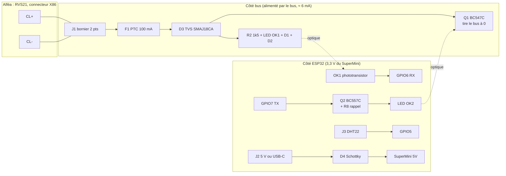

# 09 — Design de la carte d'interface BSB pour ESP32-C3 SuperMini

> **Résumé**
> Carte porteuse 2 couches de **70 × 49 mm** (placement réel, §6 ; le 50 × 40 mm initial n'était pas tenable avec les borniers et l'isolation). Le SuperMini s'y enfiche (2 × 8 broches au pas de 2,54 mm). Elle reprend **la topologie éprouvée de l'adaptateur officiel V3** : 2 × 4N25, BC547/BC557, mêmes valeurs. Les **écarts sont limités et justifiés** : rappel de TX au démarrage, transistor de bus en gain C, TVS et PTC sur l'entrée, retrait de l'EEPROM, entrée DHT22 protégée, entrée 5 V avec diode anti-retour.
> **Isolation galvanique conservée** : rien n'est prélevé sur le bus pour l'ESP32. L'alimentation vient d'un **chargeur USB 5 V** (défaut, aucune intervention sur le 230 V) ou d'un module 5 V rail DIN (option).
> Brochage : RX = GPIO6, TX = GPIO7, DHT22 = GPIO5, LED = GPIO8 (sur le SuperMini). **Projet KiCad 9 généré dans `alfea/hardware/carte_bsb_c3/`** : ERC 0, DRC 0, parité schéma/PCB 0 ; **PCB placé, non routé** (§9).
> **Avant tout branchement**, X86 doit être mesuré (§8) : polarité et tension du bus ne sont pas documentées par Atlantic.

Conventions : **[CONSTATÉ]**, **[SUPPOSÉ]**, **[À VÉRIFIER]**. Les calculs reprennent les valeurs de 06 §3 (4N25 : CTR ≥ 20 % à 10 mA, Vf 1,2 V ; C3 : V_IH ≥ 2,48 V, V_IL ≤ 0,83 V).

---

## 1. Schéma fonctionnel



Aucun conducteur ne traverse la frontière bus/ESP32 : les deux seuls chemins sont optiques (OK1 en réception, OK2 en émission).

## 2. Schéma électrique détaillé (netlist)

Nœuds côté bus : `BUS+` (après F1), `BUS-` (= CL-). Nœuds côté ESP32 : `+3V3` et `GND` (broches du SuperMini), `+5V`.

### 2.1 Entrée et protections (côté bus)
| Réf. | Valeur | Connexion | Rôle |
|---|---|---|---|
| J1 | bornier 2 pts, pas 5,08 | 1 = CL+, 2 = CL- | raccordement X86 |
| F1 | PTC 0,10 A maintien | J1-1 → `BUS+` | limite le courant si erreur de câblage (ex. 24 V) **[écart : absent en V3]** |
| D3 | TVS bidirectionnelle SMAJ18CA (V_RWM 18 V, V_BR ≥ 20 V) | `BUS+` ↔ `BUS-` | surtensions et ESD ; bidirectionnelle pour tolérer une inversion de polarité **[écart]** |

### 2.2 Réception : bus → GPIO6 (identique à V3)
| Réf. | Valeur | Connexion |
|---|---|---|
| R2 | 1,5 kΩ, 1206 (250 mW) | `BUS+` → OK1 broche 1 (anode) |
| OK1 | 4N25 | 1 anode, 2 cathode → D1 anode ; 5 collecteur → `+3V3`, 4 émetteur → `RX` (GPIO6), 6 base → R4 |
| D1 | LED rouge | D1 cathode → D2 anode (témoin d'activité du bus) |
| D2 | 1N4148 | D2 cathode → `BUS-` (protection contre l'inversion) |
| R4 | 330 kΩ | OK1-6 (base) → OK1-4 (émetteur) : accélère le blocage |
| R5 | 4,7 kΩ | `RX` → `GND` |

Calcul (06 §3.1) : seuil ≈ 3,7 V ; I_F = (V_bus − 3,7) / 1 500 = 6,2 mA à 13 V ; Ic nécessaire = 2,48 V / 4,7 kΩ = 0,53 mA ; marge ×1,2 à ×2,3 selon le CTR réel. P(R2) = (15 − 3,7) × 7,5 mA = **85 mW** au pire (bus à 15 V), d'où le boîtier 1206 (marge ×2,9).

### 2.3 Émission : GPIO7 → bus
| Réf. | Valeur | Connexion |
|---|---|---|
| R6 | 4,7 kΩ | `TX` (GPIO7) → base de Q2 |
| **R8** | **10 kΩ** | base de Q2 → `+3V3` **[écart : rappel au démarrage]** |
| Q2 | BC557C (PNP) | E → `+3V3`, C → R3 |
| R3 | 300 Ω | Q2-C → OK2 broche 1 (anode) ; OK2-2 → `GND` |
| OK2 | 4N25 | 5 collecteur → R1, 4 émetteur → base de Q1 |
| R1 | 330 kΩ (empreinte compatible 100 kΩ) | `BUS+` → OK2-5 |
| R7 | 330 kΩ | base de Q1 → `BUS-` |
| **Q1** | **BC547C** (NPN) | C → `BUS+`, E → `BUS-` **[écart : gain C imposé]** |

Calculs (VCC = 3,3 V) :
- **TX bas** : I_F(OK2) = (3,3 − 0,2 − 1,2) / 300 = **6,3 mA**. Ib(Q2) = (3,3 − 0,7) / 4,7 k − 0,7 / 10 k = 0,55 − 0,07 = **0,48 mA** ; Ic = 6,3 mA, β forcé ≈ 13 ≪ β min (420) : saturé. Courant sur la GPIO : 0,55 mA.
- **TX haut ou haute impédance** (reset, bootloader) : R8 maintient V_EB = 0 et Q2 reste bloqué. **Sans R8**, une GPIO flottante ou tirée bas par un pull-down interne au reset pourrait allumer Q2 et **tirer le bus à 0 pendant le démarrage** (06 V5). R8 consomme 0,33 mA quand TX est bas, ce qui est négligeable.
- **Pouvoir de descente de Q1** : Ib(Q1) = (V_bus − 0,7 − 0,3) / R1 − 0,7 / R7 = (13 − 1,0) / 330 k − 2,1 µA ≈ **34 µA**. Ic max = β × Ib : 6,8 mA avec un BC547B (β min 200), **14 mA avec un BC547C** (β min 420). L'adaptateur officiel fonctionne, ce qui suggère que la source du bus débite moins de quelques mA en court-circuit [SUPPOSÉ]. Le gain C double la marge sans changer la topologie. Si la mesure du niveau bas pendant nos trames (GATE 3, oscilloscope) dépasse ~1 V, on passe R1 à 100 kΩ (Ib ≈ 115 µA).

### 2.4 Entrée DHT22 (D5)
| Réf. | Valeur | Connexion | Rôle |
|---|---|---|---|
| J3 | JST XH 3 pts | 1 = `+3V3`, 2 = DATA, 3 = `GND` | capteur déporté |
| R9 | 4,7 kΩ | DATA → `+3V3` | rappel du bus 1-fil (DHT22 : 4,7-10 kΩ) |
| R10 | 100 Ω | DATA → GPIO5 | limite le courant d'une décharge ESD dans la GPIO |
| D5 | PESD5V0S1BA | DATA ↔ `GND` | ESD sur câble externe |
| C3 | 100 nF | `+3V3` ↔ `GND` près de J3 | découplage du capteur |

Alimentation du DHT22 en 3,3 V : la datasheet AM2302 donne 3,3-6 V, avec une portée réduite à 3,3 V. On vise un **câble ≤ 3 m** [SUPPOSÉ : ordre de grandeur courant pour un DHT22 en 3,3 V, à valider sur site]. Ne pas l'alimenter en 5 V : DATA serait rappelée à 5 V et dépasserait la tension maximale de la GPIO (3,6 V).

### 2.5 Alimentation
| Réf. | Valeur | Connexion |
|---|---|---|
| J2 | bornier 2 pts, pas 3,5 | 5 V externe (option rail DIN) |
| D4 | SS14 (Schottky 1 A, 40 V) | J2(+) → `+5V` (broche 5V du SuperMini) : empêche le 5 V de l'USB-C de remonter dans l'alimentation externe |
| C1 | 100 µF, 10 V | `+5V` ↔ `GND` : réservoir pour les pointes d'émission WiFi (risque R4 de 07) |
| C2 | 100 nF X7R | `+5V` ↔ `GND` |

Pas de condensateur ajouté sur le `+3V3` : la stabilité du LDO du SuperMini (ME6211 ou LP5907) avec une capacité de sortie supplémentaire n'est pas garantie [SUPPOSÉ].

## 3. Adaptation au SuperMini

| Broche SuperMini | Usage | Justification |
|---|---|---|
| 5V, GND | alimentation (USB-C du SuperMini **ou** J2 via D4) | |
| 3V3 | côté MCU de l'interface (< 10 mA, §4) | même potentiel que les GPIO : condition 06 §3.2 respectée |
| **GPIO6** | RX (UART1) | pas de strapping ; pin JTAG (MTCK) non utilisé, JTAG passe par l'USB [SUPPOSÉ : configuration eFuse par défaut] |
| **GPIO7** | TX (UART1) | idem (MTDO) ; **pas** GPIO21 (U0TXD, log ROM à 115 200 bauds au boot) |
| **GPIO5** | DHT22 | libre, pas de strapping |
| GPIO8 | LED bleue du SuperMini (active à l'état bas [À VÉRIFIER sur le lot]) | strapping : doit rester haut au boot, ce qu'assure la LED tirée au 3V3. l'amont ne fixe `LED_BUILTIN = 8` que pour les cartes Olimex C3/C6 (`BSB_LAN/BSB_LAN.ino:211-217`) : le définir dans notre configuration, sauf si la variante `esp32c3` d'arduino-esp32 le fait déjà [À VÉRIFIER au build] |
| GPIO9 | bouton BOOT du SuperMini | strapping, non utilisé |
| GPIO2 | non utilisé | strapping |
| GPIO18/19 | USB (flash, console) | |

Configuration logicielle : `bus_pins = {6, 7}`, `DHT_Pins[0] = 5` (08 §1.2), sans modification du code.

## 4. Alimentation : justification

**Pas d'alimentation par le bus.** Ni la puissance disponible sur X86 ni l'impédance de source ne sont documentées (06 §3.4, Q5). Surtout, alimenter l'ESP32 depuis G+ ou CL+ **relierait sa masse au bus**, ce qui annulerait l'isolation des optocoupleurs (décision D6). Une surconsommation pourrait aussi faire redémarrer le régulateur.

**Pas de 5 V documenté sur le RVS21** : je n'ai trouvé aucune sortie 5 V dans la notice R32 ni dans la doc BSB-LAN. G+ (alimentation des sondes d'ambiance) n'est pas prévu pour 100 à 350 mA.

| Solution | + | − | Choix |
|---|---|---|---|
| **Chargeur USB 5 V ≥ 1 A** (marque, marquage CE) + câble USB-C vers le SuperMini | aucune intervention sur le 230 V ; remplaçable | une prise 230 V à proximité ; câble USB exposé | **par défaut** |
| Module rail DIN 5 V (ex. Mean Well HDR-15-5 : 5 V 2,4 A, classe II, 17,5 mm) câblé sur J2 | propre, durable en chaufferie | raccordement 230 V à faire par une personne qualifiée, sans toucher au câblage de la PAC | option |
| Convertisseur AC/DC sur la carte | compact | 230 V sur notre carte : isolation renforcée, CE | **rejeté** |

Budget [SUPPOSÉ, ordres de grandeur de datasheet, à mesurer en T1] :

| Consommateur | Moyen | Pointe |
|---|---|---|
| ESP32-C3, WiFi connecté | 80-100 mA | 350 mA (émission) |
| Interface côté MCU (OK2 6,3 mA × taux d'émission < 10 %, R5, R8, DHT22) | < 3 mA | 9 mA |
| **Total sur 5 V** | **≈ 0,1 A (0,5 W)** | **≈ 0,36 A** |
| Prélevé sur le bus (OK1 + D1) | 6 mA | + courant de Q1 pendant nos bits à 0 |

Un chargeur de 1 A donne une marge ×2,8 sur la pointe. Avec un LP5907 (250 mA, risque R4), C1 absorbe la pointe : ΔV ≈ I·Δt / C = 0,1 A × 1 ms / 100 µF = 1 V côté 5 V, ce qui reste au-dessus du seuil de chute du LDO (≈ 3,5 V) [SUPPOSÉ : durée de pointe de 1 ms]. Préférer les lots ME6211.

## 5. Isolation, protections, CEM, environnement

| Sujet | Disposition |
|---|---|
| Isolation | les deux côtés sont en TBTS ; l'isolation est fonctionnelle (boucles de masse, surtensions de mode commun), pas de sécurité. **Distance ≥ 3 mm** entre cuivres bus et MCU, sous les 4N25 (rangées à 7,62 mm) ; fente de 1 mm optionnelle. Isolement du 4N25 : 5 000 V eff. |
| Polarité | D2 (réception) + TVS bidirectionnelle : une inversion ne détruit rien et rien ne fonctionne (V1 de 06). La LED D1 éteinte signale l'inversion |
| Surtension, erreur de câblage | D3 écrête au-delà de 20 V ; F1 s'ouvre si la source débite (ex. borne 24 V) |
| ESD | D3 côté bus, D5 côté DHT22 ; manipulation avec bracelet (V7 de 06) |
| CEM | **aucun condensateur** entre CL+ et CL- (il déformerait les fronts et chargerait le bus) ; câble en paire torsadée, si possible blindée, avec le blindage à la masse **côté PAC seulement** [À VÉRIFIER : recommandation Siemens] ; éloigné des câbles du compresseur et de l'onduleur |
| Environnement | chaufferie de 0 à 50 °C [SUPPOSÉ] : composants -40/+85 °C au minimum ; boîtier ABS avec presse-étoupes, hors des projections d'eau ; vernis de tropicalisation optionnel si condensation |
| RF | antenne céramique du SuperMini au **bord de la carte**, sans cuivre dessous ni dessus (dégagement de plan de masse), boîtier non métallique. Condition RSSI ≥ −70 dBm (D1) |

## 6. Format de la carte

Placement réel (rendu `alfea/hardware/carte_bsb_c3/sorties/pcb_dessus.png`) :

```
 70 mm
┌──────────────────────────────────────────────────────────────┐
│ H1  F1  D3 R2 │OK1│ R4   J2(5 V, ouvert vers le haut)  J4 ┆ J5 │
│     D1  D2    │   │ R5   D4  C2                        SuperMini │
│J1 (BSB, ouvert│iso│ R6   C1                   (USB vers le haut) │ 49 mm
│ vers la gauche)│  │ R8   Q2                         zone antenne │
│ R1  Q1        │OK2│ R3   R9 C3 / R10 D5          sans cuivre      │
│ H2  R7        │   │      J3 (DHT22)              H3        H4    │
└──────────────────────────────────────────────────────────────┘
```
- Bande d'isolation de 3 mm (zone interdite au cuivre, x = 123,4 à 126,4 mm) entre les deux rangées de broches des 4N25.
- Zone sans cuivre de 21 × 27 mm sous et devant l'antenne du SuperMini (coin inférieur droit).

- 2 couches, FR-4 1,6 mm, finition HASL ou ENIG.
- Empreintes : CMS 0805 (1206 pour R2), 4N25 en DIP-6 traversant (ou SMD-6 « 4N25-X007 »), BC547C/BC557C en TO-92 ou BC847C/BC857C en SOT-23.
- Le SuperMini est monté sur **barrettes femelles** (remplaçable) : écartement des rangées **[À VÉRIFIER sur un exemplaire au pied à coulisse]**, 15,24 mm (0,6") attendu.
- 4 trous M3 pour entretoises ; boîtier de type 100 × 68 × 40 mm.

## 7. Nomenclature (BOM)

| Réf. | Qté | Désignation | Référence courante |
|---|---|---|---|
| U1 | 1 | ESP32-C3 SuperMini (4 Mo, LDO ME6211 de préférence) | générique |
| — | 2 | barrette femelle 1 × 8, pas de 2,54 | générique |
| OK1, OK2 | 2 | optocoupleur à sortie transistor, broche de base | Vishay **4N25** (DIP-6) |
| Q1 | 1 | NPN, gain C | **BC547C** (TO-92) / BC847C (SOT-23) |
| Q2 | 1 | PNP, gain C | **BC557C** / BC857C |
| D1 | 1 | LED rouge 0805 | générique |
| D2 | 1 | diode signal | **1N4148** / 1N4148W |
| D3 | 1 | TVS bidirectionnelle 400 W, 18 V | Littelfuse **SMAJ18CA** |
| D4 | 1 | Schottky 1 A, 40 V | **SS14** |
| D5 | 1 | protection ESD 5 V | Nexperia **PESD5V0S1BA** |
| F1 | 1 | PTC 0,10 A maintien, 60 V | Bourns **MF-MSMF010-2** (1812) |
| R1, R4, R7 | 3 | 330 kΩ 0805 1 % | générique |
| R2 | 1 | 1,5 kΩ 1206 1 % | générique |
| R3 | 1 | 300 Ω 0805 1 % | générique |
| R5, R6, R9 | 3 | 4,7 kΩ 0805 1 % | générique |
| R8 | 1 | 10 kΩ 0805 1 % | générique |
| R10 | 1 | 100 Ω 0805 | générique |
| C1 | 1 | 100 µF 10 V, électrolytique alu ou polymère | générique |
| C2, C3 | 2 | 100 nF X7R 0805 | générique |
| J1 | 1 | bornier enfichable 2 pts, pas 5,08 | Phoenix **MSTBA 2,5/2-G-5,08** + fiche **MSTB 2,5/2-ST-5,08** |
| J2 | 1 | bornier 2 pts, pas 3,5 | générique |
| J3 | 1 | embase JST XH 3 pts | JST **B3B-XH-A** |
| — | 1 | capteur T/HR | **DHT22 / AM2302** |
| — | 1 | fiche pour X86 (connecteur vert 6 pts) | **[À VÉRIFIER : pas 3,5 ou 5,0/5,08 mm, à mesurer]** |
| — | 1 | chargeur USB 5 V ≥ 1 A + câble USB-C (ou Mean Well HDR-15-5) | |

Écarts à l'adaptateur officiel V3 (règle 00 §2.4), récapitulatif : **R8** (sûreté au démarrage), **Q1 en gain C** (marge de descente du bus), **D3 et F1** (protections demandées par la mission), **suppression de la 24LC32** (inutile sur ESP32, 06 §2.4), **ajouts DHT22 et entrée 5 V** (périmètre MCU, sans effet sur le bus). Les valeurs des composants côté bus sont inchangées.

## 8. Mesure de X86 avant branchement (prérequis GATE 3)

Contexte : connecteur vert à 6 broches, rien de branché (Q2 de l'utilisateur). Sur un RVS21.831/127, l'issue #405 l'étiquette `B2 M B1 3 2 1`, et la doc BSB-LAN situe CL+ sur la broche la plus à droite et CL- sur la deuxième depuis la droite (06 V2). L'IHM étant elle-même sur le BSB (08a §1), le bus doit porter du trafic.

1. **Sécurité** : la carte de régulation côtoie du 230 V. Intervention par une personne habilitée, avec pointes de touche isolées et sans démonter de bornier sous tension. En cas de doute, faire la mesure PAC hors tension, en sondant la continuité vers les bornes sérigraphiées.
2. Relever la sérigraphie des 6 broches (photo) et le **pas** du connecteur.
3. PAC sous tension, multimètre en continu, pointe COM sur la broche supposée CL- (`2`) : mesurer chacune des autres. Attendu [SUPPOSÉ] : **12 à 15 V** sur CL+ (`1`), avec une valeur moyenne légèrement inférieure à cause du trafic.
4. Si un oscilloscope est disponible (sonde différentielle, ou oscilloscope sur batterie) : des créneaux de 208 µs entre `1` et `2` confirment le BSB. Relever le **niveau bas** et la **tension de repos**.
5. Me transmettre les mesures : elles fixent la tension nominale de D3 (SMAJ18CA ou autre) et valident le sens de raccordement de J1.

## 9. Fichiers KiCad (après la GATE 2)

| Fichier | Rôle |
|---|---|
| `alfea/hardware/gen/carte.py` | **source unique** : composants, valeurs, empreintes, références fabricant, positions sur le schéma et le PCB, affectation broche → net |
| `alfea/hardware/gen/gen_kicad.py`, `libsym.py`, `sexpr.py` | générateur : schéma (connexions par étiquettes de net), PCB (placement, nets, contour, zones interdites), projet |
| `alfea/hardware/carte_bsb_c3/carte_bsb_c3.kicad_{pro,sch,pcb}` | projet KiCad 9, ouvrable directement |
| `alfea/hardware/carte_bsb_c3/sorties/` | `schema.pdf`, `bom.csv`, `pcb.svg`, `pcb_dessus.png`, rapports `erc.rpt` et `drc.rpt` |
| `docker/kicad/generer_carte.sh` | régénération et contrôles dans l'image officielle `kicad/kicad:9.0.6` |

**Régénérer** : `sh docker/kicad/generer_carte.sh` depuis la racine du dépôt. Les UUID dérivent des références, donc deux générations donnent les mêmes fichiers.

**Contrôles** [MESURÉ, image `kicad/kicad:9.0.6`] :
- ERC : **0** violation.
- Netlist exportée du schéma comparée à `carte.py` : **66 broches, 0 écart**, aucune connexion en trop.
- DRC avec parité schéma/PCB : **0** violation, **0** écart de parité. Il reste **46 connexions non routées**, ce qui est attendu tant que le PCB n'est pas routé.

**Routage : à faire.** J'ai tenté un routage automatique avec Freerouting en Docker (export Specctra DSN, zones interdites incluses), mais l'exécution du jar téléchargé a été refusée par les permissions de la session. Deux possibilités :
1. router à la main dans KiCad (46 connexions, 2 couches) ;
2. m'autoriser à exécuter Freerouting 2.1.0 (jar officiel GitHub, sha256 `2c07d58f…5def`) dans un conteneur `eclipse-temurin:21-jre`, puis reprise et DRC.

**Pistes conseillées** : 0,25 mm pour les signaux ; 0,5 mm pour `+5V`, `GND` et `BUS_N`/`BUS_P` (robustesse mécanique, le courant reste faible) ; plan de masse `GND` en face arrière **côté ESP32 uniquement**, hors zone antenne ; aucune piste ni plan dans la bande d'isolation ; garde ≥ 0,5 mm autour des nets du bus (exposés à des surtensions).

**Avant fabrication, à vérifier sur un exemplaire** :
- le brochage du SuperMini (5V, GND, 3V3, GPIO4-0 d'un côté ; GPIO5-10, 20, 21 de l'autre) et l'entraxe des rangées (15,24 mm) ;
- le sens du connecteur USB (vers le haut, débordant du bord) ;
- la position de l'antenne céramique, qui doit tomber dans la zone sans cuivre ;
- l'empreinte de la fiche X86 (pas du connecteur vert, §8).
