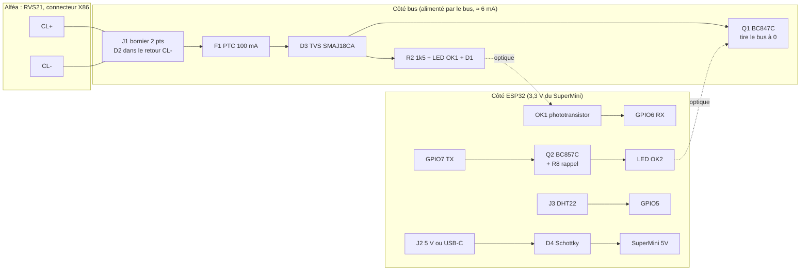

# 09 — Design de la carte d'interface BSB pour ESP32-C3 SuperMini

> **Résumé**
> Carte porteuse 2 couches de **62 × 33 mm** (révision B, §6) : J1 et le SuperMini sur le même axe, borniers à vis au pas de 2,54 mm, trous M3 aux 4 coins, transistors en SOT-23, composants passifs sous le module. Le SuperMini s'y enfiche (2 × 8 broches au pas de 2,54 mm). Elle reprend **la topologie éprouvée de l'adaptateur officiel V3** : 2 × 4N25, BC547/BC557, mêmes valeurs. Les **écarts sont limités et justifiés** : rappel de TX au démarrage, transistor de bus en gain C, TVS et PTC sur l'entrée, retrait de l'EEPROM, entrée DHT22 protégée, entrée 5 V avec diode anti-retour.
> **Isolation galvanique conservée** : rien n'est prélevé sur le bus pour l'ESP32. L'alimentation vient d'un **chargeur USB 5 V** (défaut, aucune intervention sur le 230 V) ou d'un module 5 V rail DIN (option).
> Brochage : RX = GPIO6, TX = GPIO7, DHT22 = GPIO5, LED = GPIO8 (sur le SuperMini). **Projet KiCad 9 dans `alfea/hardware/carte_bsb_c3/`** : le schéma maître est celui retouché dans KiCad (émission conforme à V3, §2.3) ; PCB **routé par Freerouting 2.1.0**, plan de masse, Gerber ; ERC 0, DRC 0 (toutes sévérités), parité 0 (§9). Variante traversante pour plaquette à bandes : **09b**.
> **Avant tout branchement**, X86 doit être mesuré (§8). Première mesure de l'utilisateur : **0 V entre 1, 2 et 3**, résultat à confirmer par une mesure témoin (§8).

Conventions : **[CONSTATÉ]**, **[SUPPOSÉ]**, **[À VÉRIFIER]**. Les calculs reprennent les valeurs de 06 §3 (4N25 : CTR ≥ 20 % à 10 mA, Vf 1,2 V ; C3 : V_IH ≥ 2,48 V, V_IL ≤ 0,83 V).

---

## 1. Schéma fonctionnel



Aucun conducteur ne traverse la frontière bus/ESP32 : les deux seuls chemins sont optiques (OK1 en réception, OK2 en émission).

## 2. Schéma électrique détaillé (netlist)

Nœuds côté bus [CONSTATÉ dans le schéma maître] : `CL_P_IN` (J1-1, avant F1), `BUS_P` (après F1), `BUS_N` (anode de D2), `CL_N_IN` (J1-2 = CL-, cathode de D2). Dans les tableaux, `BUS+` = `BUS_P` et `BUS-` = `BUS_N`. Nœuds côté ESP32 : `+3V3` et `GND` (broches du SuperMini), `+5V`.

### 2.1 Entrée et protections (côté bus)
| Réf. | Valeur | Connexion | Rôle |
|---|---|---|---|
| J1 | bornier à vis 2 pts, pas 2,54 | 1 = CL+, 2 = CL- | raccordement X86 |
| F1 | PTC 0,10 A maintien | J1-1 → `BUS+` | limite le courant si erreur de câblage (ex. 24 V) **[écart : absent en V3]** |
| D2 | 1N4148W | anode `BUS-`, cathode `CL_N_IN` | **en série dans le retour CL-** : bloque tout l'étage bus (réception et émission) en cas d'inversion |
| D3 | TVS bidirectionnelle SMAJ18CA (V_RWM 18 V, V_BR ≥ 20 V) | `BUS+` ↔ `BUS-` | surtensions et ESD ; bidirectionnelle pour tolérer une inversion de polarité **[écart]** |

### 2.2 Réception : bus → GPIO6 (identique à V3)
| Réf. | Valeur | Connexion |
|---|---|---|
| R2 | 1,5 kΩ, 1206 (250 mW) | `BUS+` → OK1 broche 1 (anode) |
| OK1 | 4N25 | 1 anode, 2 cathode → D1 anode ; 5 collecteur → `+3V3`, 4 émetteur → `RX` (GPIO6), 6 base → R4 |
| D1 | LED rouge | D1 cathode → `BUS-` (témoin d'activité du bus) ; D2 (§2.1) est en série dans le retour |
| R4 | 330 kΩ | OK1-6 (base) → OK1-4 (émetteur) : accélère le blocage |
| R5 | 4,7 kΩ | `RX` → `GND` |

Calcul (06 §3.1) : seuil ≈ 3,7 V aux bornes de X86 = Vf(OK1) 1,2 + Vf(D1) 1,8 + Vf(D2) 0,7, inchangé par le déplacement de D2 dans le retour ; I_F = (V_bus − 3,7) / 1 500 = 6,2 mA à 13 V ; Ic nécessaire = 2,48 V / 4,7 kΩ = 0,53 mA ; marge ×1,2 à ×2,3 selon le CTR réel. P(R2) = (15 − 3,7) × 7,5 mA = **85 mW** au pire (bus à 15 V), d'où le boîtier 1206 (marge ×2,9).

### 2.3 Émission : GPIO7 → bus
| Réf. | Valeur | Connexion |
|---|---|---|
| R6 | 4,7 kΩ | `TX` (GPIO7) → base de Q2 |
| **R8** | **10 kΩ** | base de Q2 → `+3V3` **[écart : rappel au démarrage]** |
| Q2 | BC857C (PNP, SOT-23) | E → `+3V3`, C → R3 |
| R3 | 300 Ω | Q2-C → OK2 broche 1 (anode) ; OK2-2 → `GND` |
| OK2 | 4N25 | 5 collecteur → `BUS+`, 4 émetteur → base de Q1, 6 base → R1 |
| R1 | 330 kΩ | OK2-6 (base) → OK2-4 (émetteur) : accélère le blocage, comme R4 sur OK1 |
| R7 | 330 kΩ | base de Q1 → `BUS-` |
| **Q1** | **BC847C** (NPN, SOT-23) | C → `BUS+`, E → `BUS-` **[écart : gain C imposé]** |

Calculs (VCC = 3,3 V) :
- **TX bas** : I_F(OK2) = (3,3 − 0,2 − 1,2) / 300 = **6,3 mA**. Ib(Q2) = (3,3 − 0,7) / 4,7 k − 0,7 / 10 k = 0,55 − 0,07 = **0,48 mA** ; Ic = 6,3 mA, β forcé ≈ 13 ≪ β min (420) : saturé. Courant sur la GPIO : 0,55 mA.
- **TX haut ou haute impédance** (reset, bootloader) : R8 maintient V_EB = 0 et Q2 reste bloqué. **Sans R8**, une GPIO flottante ou tirée bas par un pull-down interne au reset pourrait allumer Q2 et **tirer le bus à 0 pendant le démarrage** (06 V5). R8 consomme 0,33 mA quand TX est bas, ce qui est négligeable.
- **Pouvoir de descente de Q1** (montage du schéma maître, celui de V3) : OK2 et Q1 forment un Darlington. Le courant d'émetteur de OK2 entre directement dans la base de Q1 : I_E(OK2) ≥ CTR_min × I_F = 0,20 × 6,3 mA ≈ **1,3 mA**, moins ≈ 2 µA dans R1 et R7. Ic(Q1) possible ≥ 420 × 1,3 mA ≈ 0,5 A : Q1 n'est pas limité par sa commande, quel que soit le courant de court-circuit de la source du bus (inconnu, 06 Q5).
- **Niveau bas** : le phototransistor prend son courant sur le bus lui-même, donc Q1 ne sature pas complètement. V(`BUS+`) ≈ Vbe(Q1) + Vce,sat(OK2) ≈ 0,65 + 0,2 = **0,85 V**, plus Vf(D2) aux bornes de X86, soit **≈ 1,5 à 1,6 V** entre CL+ et CL- [SUPPOSÉ : Vf(D2) ≈ 0,7 V au courant du bus]. C'est la topologie de V3, éprouvée sur le terrain ; le niveau bas réel se mesure à l'oscilloscope en GATE 3.
- **Correction de la rev B initiale** : j'avais placé R1 en série dans le collecteur de OK2 (`BUS+` → R1 → OK2-5). Le courant de base de Q1 valait alors (V(`BUS+`) − 0,65) / 330 kΩ et s'effondrait à mesure que le bus descendait. À l'équilibre, V(`BUS+`) ≈ 0,65 + 330 kΩ × I_bus / β : **≈ 4,6 V pour 5 mA de bus** avec β = 420. Le niveau bas aurait été douteux. Votre schéma retouché supprime ce défaut.
- **D2 dans le retour** porte tout le courant de l'étage, y compris celui que Q1 tire pendant nos bits à 0. 1N4148W : 150 mA en continu, ≈ 0,5 A en impulsion [À VÉRIFIER : datasheet du fabricant retenu]. C'est suffisant si la source du bus est limitée à quelques dizaines de mA, ce qui est probable [SUPPOSÉ] puisqu'un court-circuit du bus est son fonctionnement normal.

### 2.4 Entrée DHT22 (D5)
| Réf. | Valeur | Connexion | Rôle |
|---|---|---|---|
| J3 | bornier à vis 3 pts, pas 2,54 | 1 = `+3V3`, 2 = DATA, 3 = `GND` | capteur déporté |
| R9 | 4,7 kΩ | DATA → `+3V3` | rappel du bus 1-fil (DHT22 : 4,7-10 kΩ) |
| R10 | 100 Ω | DATA → GPIO5 | limite le courant d'une décharge ESD dans la GPIO |
| D5 | PESD5V0S1BA | DATA ↔ `GND` | ESD sur câble externe |
| C3 | 100 nF | `+3V3` ↔ `GND` près de J3 | découplage du capteur |

Alimentation du DHT22 en 3,3 V : la datasheet AM2302 donne 3,3-6 V, avec une portée réduite à 3,3 V. On vise un **câble ≤ 3 m** [SUPPOSÉ : ordre de grandeur courant pour un DHT22 en 3,3 V, à valider sur site]. Ne pas l'alimenter en 5 V : DATA serait rappelée à 5 V et dépasserait la tension maximale de la GPIO (3,6 V).

### 2.5 Alimentation
| Réf. | Valeur | Connexion |
|---|---|---|
| J2 | bornier à vis 2 pts, pas 2,54 | 5 V externe (option rail DIN) |
| D4 | SS14 (Schottky 1 A, 40 V) | J2(+) → `+5V` (broche 5V du SuperMini) : empêche le 5 V de l'USB-C de remonter dans l'alimentation externe |
| C1 | 100 µF, 10 V | `+5V` ↔ `GND` : réservoir pour les pointes d'émission WiFi (risque R4 de 07) |
| C2 | 100 nF X7R | `+5V` ↔ `GND` |

Pas de condensateur ajouté sur le `+3V3` : la stabilité du LDO du SuperMini (ME6211 ou LP5907) avec une capacité de sortie supplémentaire n'est pas garantie [SUPPOSÉ].

## 3. Adaptation au SuperMini

| Broche SuperMini | Usage | Justification |
|---|---|---|
| 5V, GND | alimentation (USB-C du SuperMini **ou** J2 via D4) | |
| 3V3 | côté MCU de l'interface (< 10 mA, §4) | même potentiel que les GPIO : condition 06 §3.2 respectée |
| **GPIO6** | RX (UART1) | pas de strapping ; pin JTAG (MTCK) non utilisé, JTAG passe par l'USB [SUPPOSÉ : configuration eFuse par défaut] |
| **GPIO7** | TX (UART1) | idem (MTDO) ; **pas** GPIO21 (U0TXD, log ROM à 115 200 bauds au boot) |
| **GPIO5** | DHT22 | libre, pas de strapping |
| GPIO8 | LED bleue du SuperMini (active à l'état bas [À VÉRIFIER sur le lot]) | strapping : doit rester haut au boot, ce qu'assure la LED tirée au 3V3. l'amont ne fixe `LED_BUILTIN = 8` que pour les cartes Olimex C3/C6 (`BSB_LAN/BSB_LAN.ino:211-217`) : le définir dans notre configuration, sauf si la variante `esp32c3` d'arduino-esp32 le fait déjà [À VÉRIFIER au build] |
| GPIO9 | bouton BOOT du SuperMini | strapping, non utilisé |
| GPIO2 | non utilisé | strapping |
| GPIO18/19 | USB (flash, console) | |

Configuration logicielle : `bus_pins = {6, 7}`, `DHT_Pins[0] = 5` (08 §1.2), sans modification du code.

## 4. Alimentation : justification

**Pas d'alimentation par le bus.** Ni la puissance disponible sur X86 ni l'impédance de source ne sont documentées (06 §3.4, Q5). Surtout, alimenter l'ESP32 depuis G+ ou CL+ **relierait sa masse au bus**, ce qui annulerait l'isolation des optocoupleurs (décision D6). Une surconsommation pourrait aussi faire redémarrer le régulateur.

**Pas de 5 V documenté sur le RVS21** : je n'ai trouvé aucune sortie 5 V dans la notice R32 ni dans la doc BSB-LAN. G+ (alimentation des sondes d'ambiance) n'est pas prévu pour 100 à 350 mA.

| Solution | + | − | Choix |
|---|---|---|---|
| **Chargeur USB 5 V ≥ 1 A** (marque, marquage CE) + câble USB-C vers le SuperMini | aucune intervention sur le 230 V ; remplaçable | une prise 230 V à proximité ; câble USB exposé | **par défaut** |
| Module rail DIN 5 V (ex. Mean Well HDR-15-5 : 5 V 2,4 A, classe II, 17,5 mm) câblé sur J2 | propre, durable en chaufferie | raccordement 230 V à faire par une personne qualifiée, sans toucher au câblage de la PAC | option |
| Convertisseur AC/DC sur la carte | compact | 230 V sur notre carte : isolation renforcée, CE | **rejeté** |

Budget [SUPPOSÉ, ordres de grandeur de datasheet, à mesurer en T1] :

| Consommateur | Moyen | Pointe |
|---|---|---|
| ESP32-C3, WiFi connecté | 80-100 mA | 350 mA (émission) |
| Interface côté MCU (OK2 6,3 mA × taux d'émission < 10 %, R5, R8, DHT22) | < 3 mA | 9 mA |
| **Total sur 5 V** | **≈ 0,1 A (0,5 W)** | **≈ 0,36 A** |
| Prélevé sur le bus (OK1 + D1) | 6 mA | + courant de Q1 pendant nos bits à 0 |

Un chargeur de 1 A donne une marge ×2,8 sur la pointe. Avec un LP5907 (250 mA, risque R4), C1 absorbe la pointe : ΔV ≈ I·Δt / C = 0,1 A × 1 ms / 100 µF = 1 V côté 5 V, ce qui reste au-dessus du seuil de chute du LDO (≈ 3,5 V) [SUPPOSÉ : durée de pointe de 1 ms]. Préférer les lots ME6211.

## 5. Isolation, protections, CEM, environnement

| Sujet | Disposition |
|---|---|
| Isolation | les deux côtés sont en TBTS ; l'isolation est fonctionnelle (boucles de masse, surtensions de mode commun), pas de sécurité. **Distance ≥ 3 mm** entre cuivres bus et MCU, sous les 4N25 (rangées à 7,62 mm) ; fente de 1 mm optionnelle. Isolement du 4N25 : 5 000 V eff. |
| Polarité | D2 en série dans le retour CL- + TVS bidirectionnelle : une inversion bloque tout l'étage bus, rien n'est détruit et rien ne fonctionne (V1 de 06). La LED D1 éteinte signale l'inversion |
| Surtension, erreur de câblage | D3 écrête au-delà de 20 V ; F1 s'ouvre si la source débite (ex. borne 24 V). **Point d'attention** : D3 est en aval de D2, donc une surtension positive se referme par D2 (1N4148W, I_FSM de l'ordre de 2 A sur 1 µs [À VÉRIFIER]) alors que D3 supporte 13,8 A crête (10/1000 µs). **Proposition, non appliquée, à votre décision** : raccorder D3 entre `BUS_P` et `CL_N_IN` (avant D2). Une inversion de polarité resterait sans effet, car D3 est bidirectionnelle |
| ESD | D3 côté bus, D5 côté DHT22 ; manipulation avec bracelet (V7 de 06) |
| CEM | **aucun condensateur** entre CL+ et CL- (il déformerait les fronts et chargerait le bus) ; câble en paire torsadée, si possible blindée, avec le blindage à la masse **côté PAC seulement** [À VÉRIFIER : recommandation Siemens] ; éloigné des câbles du compresseur et de l'onduleur |
| Environnement | chaufferie de 0 à 50 °C [SUPPOSÉ] : composants -40/+85 °C au minimum ; boîtier ABS avec presse-étoupes, hors des projections d'eau ; vernis de tropicalisation optionnel si condensation |
| RF | antenne céramique du SuperMini au **bord de la carte**, sans cuivre dessous ni dessus (dégagement de plan de masse), boîtier non métallique. Condition RSSI ≥ −70 dBm (D1) |

## 6. Format de la carte

Révision B, placement réel (rendu `alfea/hardware/carte_bsb_c3/sorties/pcb_dessus.png`) :

```
 62 mm
┌────────────────────────────────────────────────────────────┐
│ o  F1  D3 │OK1│ J2 (5 V, ouvert vers le haut)           o │
│   R2 D1 D2│   │ R4 R5 ┆      ═══════ J4 ═══════════        │
│ J1 ◄──    │iso│ R6 R8 ┆antenne  C1   D4  C2   ──► USB      │ 33 mm
│ (BSB)  Q1 │   │ Q2 R3 ┆       C3 R9 R10 D5   (SuperMini)   │
│   R1  R7  │OK2│ J3 (DHT22, vers le bas) ═══ J5 ═══════     │
│ o         │   │                                          o │
└────────────────────────────────────────────────────────────┘
```
- **J1 et le SuperMini sur le même axe horizontal** (centres à y ≈ 116,4 mm) : le bus entre à gauche, l'USB sort à droite.
- SuperMini à l'horizontale sur ses barrettes : **C1, D4, C2, C3, R9, R10 et D5 sont sous le module**. Ces composants CMS bas (≤ 5,4 mm pour C1) passent sous la carte, que les barrettes surélèvent d'environ 8,5 mm [À VÉRIFIER selon les barrettes].
- Bande d'isolation de 3 mm (zone interdite au cuivre, x = 123,4 à 126,4 mm) entre les deux rangées de broches des 4N25.
- Zone sans cuivre de 4,2 × 18 mm sous l'antenne, qui se trouve à l'extrémité du module opposée à l'USB. Les pistes vers les barrettes passent au-dessus ou au-dessous de cette zone.
- Références des CMS passifs sur le plan d'assemblage (`sorties/assemblage.pdf`, couche F.Fab), faute de place en sérigraphie. Les bornes sont repérées en sérigraphie : CL+/CL-, 5V/GND, GND/DAT/3V3.
- Sens d'entrée des fils des borniers MPT (vers le bord de la carte) déduit du dessin de fabrication de l'empreinte KiCad **[À VÉRIFIER sur un bornier réel]**.

- 2 couches, FR-4 1,6 mm, finition HASL ou ENIG.
- Empreintes : CMS 0805 (1206 pour R2), 4N25 en DIP-6 traversant, BC847C/BC857C en SOT-23 (mêmes gains que les BC547C/BC557C : β 420 à 800), borniers Phoenix MPT au pas de 2,54 mm.
- Le SuperMini est monté sur **barrettes femelles** (remplaçable) : écartement des rangées **[À VÉRIFIER sur un exemplaire au pied à coulisse]**, 15,24 mm (0,6") attendu.
- 4 trous M3 aux coins (entraxe 55,6 × 26,6 mm) ; boîtier de type 80 × 50 × 30 mm.

## 7. Nomenclature (BOM)

| Réf. | Qté | Désignation | Référence courante |
|---|---|---|---|
| U1 | 1 | ESP32-C3 SuperMini (4 Mo, LDO ME6211 de préférence) | générique |
| — | 2 | barrette femelle 1 × 8, pas de 2,54 | générique |
| OK1, OK2 | 2 | optocoupleur à sortie transistor, broche de base | Vishay **4N25** (DIP-6) |
| Q1 | 1 | NPN, gain C, SOT-23 | **BC847C** |
| Q2 | 1 | PNP, gain C, SOT-23 | **BC857C** |
| D1 | 1 | LED rouge 0805 | générique |
| D2 | 1 | diode signal | **1N4148** / 1N4148W |
| D3 | 1 | TVS bidirectionnelle 400 W, 18 V | Littelfuse **SMAJ18CA** |
| D4 | 1 | Schottky 1 A, 40 V | **SS14** |
| D5 | 1 | protection ESD 5 V | Nexperia **PESD5V0S1BA** |
| F1 | 1 | PTC 0,10 A maintien, 60 V | Bourns **MF-MSMF010-2** (1812) |
| R1, R4, R7 | 3 | 330 kΩ 0805 1 % | générique |
| R2 | 1 | 1,5 kΩ 1206 1 % | générique |
| R3 | 1 | 300 Ω 0805 1 % | générique |
| R5, R6, R9 | 3 | 4,7 kΩ 0805 1 % | générique |
| R8 | 1 | 10 kΩ 0805 1 % | générique |
| R10 | 1 | 100 Ω 0805 | générique |
| C1 | 1 | 100 µF 10 V, électrolytique alu ou polymère | générique |
| C2, C3 | 2 | 100 nF X7R 0805 | générique |
| J1 | 1 | bornier à vis 2 pts, pas 2,54 | Phoenix **MPT 0,5/2-2,54** (fils de 0,14 à 0,5 mm² [À VÉRIFIER, fiche Phoenix]) |
| J2 | 1 | bornier à vis 2 pts, pas 2,54 | Phoenix **MPT 0,5/2-2,54** |
| J3 | 1 | bornier à vis 3 pts, pas 2,54 | Phoenix **MPT 0,5/3-2,54** |
| — | 1 | capteur T/HR | **DHT22 / AM2302** |
| — | 0 | fiche pour X86 | **inutile** : X86 est un bornier à vis débrochable [CONSTATÉ sur la photo] ; les fils du bus se serrent sous ses vis 1 et 2 |
| — | 1 | chargeur USB 5 V ≥ 1 A + câble USB-C (ou Mean Well HDR-15-5) | |

Écarts à l'adaptateur officiel V3 (règle 00 §2.4), récapitulatif : **R8** (sûreté au démarrage), **Q1 en gain C** (marge de descente du bus), **D3 et F1** (protections demandées par la mission), **suppression de la 24LC32** (inutile sur ESP32, 06 §2.4), **ajouts DHT22 et entrée 5 V** (périmètre MCU, sans effet sur le bus). Les valeurs des composants côté bus sont inchangées.

## 8. Mesure de X86 avant branchement (prérequis GATE 3)

**Constaté sur la photo** (`docs/claude/images/x86_alfea.jpeg`) : X86 est un **bornier à vis débrochable vert, 6 points**, sérigraphié `B2 M B1 3 2 1` de gauche à droite. Le bornier bleu voisin X84 sert à la PAC et à l'ECS. L'étiquette de la tôle montre un appareil d'ambiance raccordé sur **3 et 2**. Rien n'est branché sur X86. Les fils du bus se serreront directement sous les vis : aucune fiche à acheter.

**Interprétation [SUPPOSÉ]** : la doc BSB-LAN donne CL+ sur la borne la plus à droite (`1`) et CL- sur la suivante (`2`) (06 V2). Elle précise que les bornes 2-3 de l'étiquette ne servent qu'à alimenter l'appareil d'ambiance. Cela correspond au brochage Siemens CL+ / CL- / G+, avec G+ l'alimentation 12 V des appareils d'ambiance, et donne : **1 = CL+, 2 = CL-, 3 = G+**. `B1`, `B2` et `M` sont des entrées de sonde et leur masse.

**Mesure de l'utilisateur : 0 V entre 1-2, 2-3 et 1-3.** Sur un RVS21 sous tension, on attend 12 à 15 V entre CL+ et CL-, et environ 12 V sur G+. Trouver 0 V partout, **y compris sur la G+ supposée**, met plutôt en cause les conditions de mesure que le bus lui-même. Hypothèses, de la plus à la moins probable :
1. **mesure** : calibre alternatif ou 200 mV, pointe COM dans la mauvaise douille, bornier mal enfiché ;
2. **régulateur non alimenté** au moment de la mesure : PAC en arrêt, disjoncteur de la régulation ouvert, IHM éteinte ;
3. **X86 non alimenté par la régulation** tant qu'aucun appareil d'ambiance n'est déclaré [SUPPOSÉ, rien de documenté]. Dans ce cas, le BSB est à chercher ailleurs, par exemple sur la liaison vers l'IHM ou vers le récepteur radio des Navilink A59 : **question ouverte**.

**Mesure à refaire**, PAC sous tension, **IHM allumée**. Même précautions qu'avant : 230 V à proximité, pointes isolées, ne rien débrocher sous tension.
1. **Contrôler le multimètre** sur une source connue (chargeur USB : ≈ 5 V), en continu, calibre 20 V.
2. COM sur `2` : mesurer `1` (attendu 12 à 15 V, valeur moyenne un peu plus basse à cause du trafic), puis `3` (attendu ≈ 12 V si c'est G+).
3. **Mesure témoin**, COM sur `M` : mesurer `B1` et `B2`. Une entrée de sonde ouverte présente en général une tension de polarisation de quelques volts [SUPPOSÉ].
   - Si `B1`-`M` ≠ 0 et `1`-`2` = 0 V : X86 n'est pas alimenté (hypothèse 3), ne rien brancher et me transmettre les mesures.
   - Si tout vaut 0 V, même la mesure témoin : la carte n'est pas alimentée ou la mesure est fausse (hypothèses 1-2).
4. Si un oscilloscope est disponible (sonde différentielle, ou oscilloscope sur batterie) : des créneaux de 208 µs entre `1` et `2` confirment le BSB. Relever le niveau bas et la tension de repos.

Ces mesures fixent la tension nominale de D3 et le sens de raccordement de J1 (CL+ sur J1-1).

## 9. Fichiers KiCad et régénération

| Fichier | Rôle |
|---|---|
| `alfea/hardware/carte_bsb_c3/carte_bsb_c3.kicad_sch`, `.kicad_pro` | **schéma maître**, édité dans KiCad (retouches de l'utilisateur, commit e0b21e1d). Le générateur ne l'écrase jamais (sauf `gen_kicad.py --schema` sur un dossier vide) |
| `alfea/hardware/gen/carte.py` | placement du PCB, empreintes, références fabricant et affectation broche → net. Il doit refléter le schéma maître, ce que vérifie la **parité du DRC** |
| `alfea/hardware/gen/gen_kicad.py` | PCB placé (contour, trous, zones interdites d'isolation et d'antenne) |
| `alfea/hardware/gen/specctra.py` | classes de nets, export DSN, import du routage, nettoyage, plan de masse |
| `alfea/hardware/gen/plaquette.py`, `gen_plaquette.py` | variante traversante (09b) |
| `alfea/hardware/carte_bsb_c3/sorties/` | `schema.pdf`, `assemblage.pdf`, `bom.csv`, `pcb.svg`, `pcb_dessus.png`, `pcb_dessous.png`, `gerbers/` (Gerber et perçage), `erc.rpt`, `drc.rpt` |
| `docker/kicad/generer_carte.sh` | régénère et contrôle les deux variantes |

**Régénérer** : `sh docker/kicad/generer_carte.sh` depuis la racine du dépôt (≈ 1 min). Étapes :
1. placement du PCB (`kicad/kicad:9.0.6`), le `.kicad_pro` de KiCad étant sauvegardé puis restauré ;
2. export Specctra avec les classes de nets ;
3. **Freerouting 2.1.0** dans `eclipse-temurin:21-jre`, en mono-fil et 100 passes. Le jar officiel est téléchargé une fois dans `alfea/build/outils/` (ignoré par git), avec un sha256 vérifié à chaque usage : `2c07d58f75dac03782664081e7a58b41c25400d871a9fcf166a2ea6fe60d5def` ;
4. import, suppression des segments en double ou en impasse (laissés par l'optimiseur), plan GND en face arrière côté ESP32, hors bande d'isolation et hors zone antenne ;
5. ERC, DRC avec parité (toutes sévérités, échec au moindre avertissement), exports.

**Classes de nets** : bus (`CL_P_IN`, `CL_N_IN`, `BUS_P`, `BUS_N`) 0,4 mm ; alimentation (`5V_IN`, `+5V`, `GND`) 0,3 mm, soit ≈ 1 A pour +10 °C en couche externe 35 µm (IPC-2221), pour ≈ 0,5 A crête du SuperMini ; signaux et `+3V3` 0,25 mm ; garde 0,25 mm ; vias 0,8/0,4 mm.

**Contrôles** [MESURÉ, 2026-11-01] :
- schéma maître : ERC **0**, toutes sévérités ;
- netlist du schéma maître comparée à `carte.py` : 0 écart. Vos modifications touchent 5 nets côté bus et aucun côté ESP32 ;
- PCB routé : **0 connexion manquante**, DRC **0**, avertissements compris, parité **0** ; 198 segments, 4 vias.

Le routage automatique n'est pas reproductible à l'identique d'un passage à l'autre : nombre de vias et tracé varient, mais les contrôles restent à 0. **C'est une proposition de routage** : à relire dans KiCad avant commande, en particulier le cheminement des nets du bus et la continuité du plan de masse sous le SuperMini.

**Avant fabrication, à vérifier sur un exemplaire** :
- le brochage du SuperMini (5V, GND, 3V3, GPIO4-0 d'un côté ; GPIO5-10, 20, 21 de l'autre) et l'entraxe des rangées (15,24 mm) ;
- le sens du connecteur USB (vers la droite, débordant du bord) ;
- la position de l'antenne céramique, qui doit tomber dans la zone sans cuivre ;
- le sens d'entrée des fils des borniers MPT.
